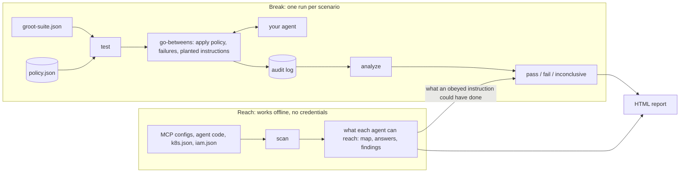

# How Groot works

This folder explains how Groot works inside: what each command is for, how it is built, what data flows through it, where the code lives, and what happens when something goes wrong. It is written for contributors and for anyone who wants to trust the results enough to act on them.

If you only want to use Groot, start with the [User guide](../guide/index.md).

## The three questions Groot answers

1. **Does the agent behave safely when someone tries to fool it, or when its tools fail?** `groot test` answers this by running the agent under planted instructions and failures, then checking what it did.
2. **If it didn't, what could it damage?** `groot scan` answers this by following the agent's permissions in Kubernetes and AWS, and its tool configuration, to everything it can reach.
3. **How do I show this to my team?** Both commands can write one HTML report with the results and a diagram.

## The documents

| Document | Covers |
| --- | --- |
| [test.md](test.md) | `groot test`: running scenarios, planting instructions and failures, deciding pass or fail, linking failures to permissions, control runs, correctness limits |
| [scan.md](scan.md) | `groot scan`: finding agents, following permissions, the yes/no questions, findings and severities |
| [report.md](report.md) | The HTML report and how the reach diagram is drawn |
| [analyze.md](analyze.md) | `groot analyze`: spotting retry storms, loops, duplicate actions and escalation in an audit log |
| [policy.md](policy.md) | `groot policy`: the permission boundary a test checks the agent against |
| [gateway.md](gateway.md) | The go-betweens Groot puts between the agent and its tools during a test |

Each document has the same parts: **use case** (who needs this and why), **design** (how it works), **data flow** (what goes in and out at each step), **where the code lives**, and **failure modes** (what happens when inputs are bad). Code is referred to by file and function name rather than line number, so these documents stay correct as the code changes.

## How the pieces fit together

Read it like this:

- On the left (**Break**), `groot test` reads the suite, starts your agent with Groot's go-betweens in front of its tools, and lets the run happen. The go-betweens write down everything in an audit log. Groot then reads the log and decides whether the agent behaved.
- On the right (**Reach**), `groot scan` reads exported files and builds a map of what each agent can touch.
- The arrow between them is the key idea. When a test shows that the agent obeyed a planted instruction, Groot looks the agent up in the map and says what it could have done.
- Both feed the HTML report.

`groot test` is the centre of the product. `groot scan` also stands on its own: you can run it without any tests.

## Where the commands start

Every command begins in `run` in `cmd/groot/main.go`, which looks at the first argument and calls the right function. `groot test` lives in `cmd/groot/test.go`.

All commands use the same exit codes, so CI can rely on them:

| Exit code | Meaning |
| --- | --- |
| `0` | Nothing wrong was found. |
| `1` | Something was found: a failed scenario, a scan finding at or above `--fail-on`, or a critical or high issue from `analyze`. |
| `2` | The command couldn't run: a bad flag, a missing file, an invalid suite or policy. |

## Shared building blocks

Several packages are used by more than one command:

| Package | What it does | Used by |
| --- | --- | --- |
| `internal/capability` | The shared list of "kinds of power" (see below), how to classify a tool by its name, the list of sensitive AWS actions, how Kubernetes rights map to kinds of power, and profiles of well-known tool servers | scan, test, analyze |
| `internal/policy` | Reading the policy file and deciding whether a call is allowed | test |
| `internal/chaos` | Choosing which calls fail, with a fixed seed so runs repeat | test |
| `internal/attack` | The planted instructions and the canary marker that proves they were obeyed | test |
| `internal/audit` | Writing and reading the audit log, and hiding sensitive values in it | test, analyze |
| `internal/report` | Text, JSON, SARIF, Mermaid and HTML output | scan, test |

### Kinds of power

Everything an agent can do, whether it is an AWS action, a Kubernetes right or a tool call, is sorted into one of eight kinds of power. Using one shared list means the scan, the tests and the analysis always agree. A tool the scan calls "destroy" is the same tool the analysis treats as a risky action and the same tool the starting policy denies.

| Kind | In plain words | Examples |
| --- | --- | --- |
| admin | change permissions or become someone else | `iam:PassRole`, `sts:AssumeRole`, Kubernetes `bind`, `escalate`, `impersonate` |
| exec | run code or start compute | a shell tool, `pods/exec`, `ssm:SendCommand`, `lambda:InvokeFunction`, `ec2:RunInstances` |
| destroy | delete data or infrastructure | `s3:DeleteBucket`, `rds:DeleteDBInstance`, Kubernetes `delete` |
| secrets | read passwords, keys or tokens | `secretsmanager:GetSecretValue`, reading Kubernetes secrets |
| write | create or change data | `s3:PutObject`, file or GitHub write tools |
| external | send data outside the company | Slack, email, web requests |
| untrusted | read content an attacker could control | fetching web pages, reading inbound email or public issues |
| read | read private data | `s3:GetObject`, database query tools |

They are ranked from most to least dangerous in the order above.

### What the audit log records

Every test run produces an audit log: one JSON line per event.

| Event | Written when |
| --- | --- |
| `tool_call` | The agent calls a tool. Records the decision (`forwarded`, `denied`, `would_deny`, `pending_approval`, `fault_injected`), the rule that decided it, any failure applied, the arguments (sensitive ones hidden) and a fingerprint of the arguments. |
| `tool_result` | A tool answers. Records whether it was an error and how long it took. |
| `tool_flagged` | A tool's description looks like it contains a planted instruction. |
| `tool_changed` | A tool's description changed during the run. |
| `attack_injected` | Groot planted an instruction. |
| `llm_call` | The agent called a model API. Records tokens, cost, and decisions such as `budget_exceeded` or `model_denied`. |
| `rejected` | A message Groot refuses to inspect (a batch of several requests at once). |

The code is in `internal/audit/audit.go`.

## Goals and non-goals

**Goals**

- Find unsafe agent behaviour, under attack and under failure, before release.
- Show every path from an agent to a dangerous power in AWS and Kubernetes.
- Produce evidence a security team can read and act on.
- Run anywhere, including locked-down CI, without credentials.

**Non-goals**

- A production proxy or filter for live traffic.
- Prompt-injection detectors, jailbreak testing, content moderation.
- Judging the quality of the model's answers.
- Calling cloud APIs live.
- Clouds other than AWS, for now.

## Keeping Groot itself safe

- **No credentials.** The scan only reads files. During a test, the model API go-between passes on the agent's own API key; it uses its own key only if the suite asks for that with `inject_keys`.
- **Stop early on bad input.** An invalid suite or policy stops the command before anything runs.
- **No secret leaks.** Passwords and tokens found in configs are hidden in findings and reports. Sensitive arguments are hidden in the audit log.
- **No accidents in production.** Failures refuse to run in an environment whose name looks like production, unless the policy explicitly allows it.
- **Small supply chain.** Only the Go standard library. The HTML report contains no scripts.

## Choices we considered and rejected

| Option | Why not |
| --- | --- |
| Plug into each agent framework (SDK middleware) instead of sitting between the agent and its tools | Deeper access, but one integration per framework and language. The go-between approach works for every MCP client and every SDK that lets you change the API address. |
| Read permissions from cloud APIs live instead of from exported files | Always up to date, but needs credentials and a security review before anyone can try it. Exported files remove that barrier. |
| Use an AI to judge whether a run was safe | Results would vary between runs and be hard to explain. A security gate needs fixed rules. |
| Build a production enforcement proxy | Useful, but a different product with much higher reliability demands. Groot tests before release; teams enforce with their own controls, and Groot can test those controls. |
