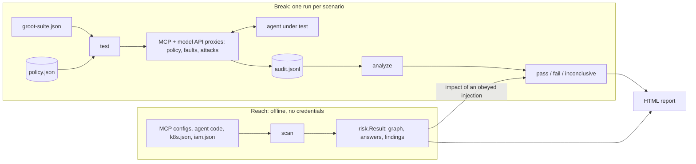

# Groot design

Groot is a security and governance tool for teams building AI agents. It answers three questions:

1. **Does the agent behave safely when attacked or when its tools fail?** (`groot test`)
2. **What could the agent damage if it didn't?** (`groot scan`)
3. **What should I show my team?** (the HTML report, from either command)

There is one design document per command, plus one for the proxies that `groot test` runs internally. Each has a use case, a design, the data flow, where the code lives, and failure modes. Code is referenced by file and function, not line number, so the docs stay true as the code moves.

| Command | What it does | Doc |
| --- | --- | --- |
| `groot test` | Runs the agent's own tests under injected attacks and faults; judges the audit log; joins failures to the agent's reach | [test.md](test.md) |
| `groot scan` | Offline scan of agents, MCP configs, Kubernetes and IAM snapshots: what each agent can reach | [scan.md](scan.md) |
| `groot graph`, `--format html`, `--html` | Self-contained HTML report with a reach graph per agent | [report.md](report.md) |
| `groot analyze` | Turns an audit log into behaviour issues (retry storms, loops, duplicate side effects, escalation) | [analyze.md](analyze.md) |
| `groot policy init\|check` | Writes and validates the permission boundary the tests check against | [policy.md](policy.md) |
| (internal) | MCP and model API proxies that apply policy, faults and attacks during a test | [gateway.md](gateway.md) |

## How the pieces fit together

`test` is the core. It drives the proxies, reuses `analyze` on the audit log they wrote, and, when the suite names a scan directory, joins an obeyed injection to what the agent's identity can reach. `scan` works on files only.

## Entry point

Every command is dispatched from `run` in `cmd/groot/main.go`. `test` lives in `cmd/groot/test.go`.

Exit codes are the same everywhere: `0` clean; `1` the command found a problem (a failed scenario, a scan finding at or above `--fail-on`, a critical or high analyze issue); `2` usage or input error.

## Shared building blocks

| Package | Role | Used by |
| --- | --- | --- |
| `internal/capability` | Capability classes and `ClassifyTool` on tool names; the AWS action catalogue; RBAC verb classes; MCP server profiles | scan, test, analyze |
| `internal/policy` | Policy file and `Decide` | test (via the proxies) |
| `internal/chaos` | Seeded fault injection (`Pick`) | test |
| `internal/attack` | Injection payloads and the canary | test |
| `internal/audit` | JSONL events, `Write`, `Read`, `Redact` | test, analyze |
| `internal/report` | Text, JSON, SARIF, Mermaid and HTML rendering | scan, test |

Because the capability model is shared, a tool the scanner calls "destroy" is the tool the analyzer treats as a side effect and the tool `groot policy init` denies.

### Capability classes

| Class | Meaning | Examples |
| --- | --- | --- |
| admin | change permissions or become someone else | `iam:PassRole`, `sts:AssumeRole`, RBAC `bind`/`escalate`/`impersonate` |
| exec | run arbitrary code or compute | shell MCP servers, `pods/exec`, `ssm:SendCommand`, `lambda:InvokeFunction`, `ec2:RunInstances` |
| destroy | delete data or infrastructure | `s3:DeleteBucket`, `rds:DeleteDBInstance`, RBAC `delete` |
| secrets | read credentials | `secretsmanager:GetSecretValue`, Kubernetes `secrets` get/list |
| write | create or modify data | `s3:PutObject`, filesystem or GitHub write tools |
| external | send data outside | Slack, email, web requests |
| untrusted | read attacker-controllable content | web fetch, browsers, inbound email |
| read | read private data | `s3:GetObject`, database query tools |

### Audit event types

`tool_call`, `tool_result`, `tool_flagged`, `tool_changed`, `rejected`, `llm_call`, `attack_injected` (`internal/audit/audit.go`). Decisions on calls: `forwarded`, `denied`, `would_deny`, `pending_approval`, `fault_injected`, `budget_exceeded`, `model_denied`.

## Goals and non-goals

Goals: find unsafe agent behaviour under attack and failure before release; show every path from an agent to a dangerous capability in AWS and Kubernetes; produce evidence a security team can read; run anywhere, including air-gapped CI, without credentials.

Non-goals: a production proxy or enforcement layer, prompt-injection classifiers, jailbreak testing, content moderation, model-quality evals, live cloud API access, clouds other than AWS (for now).

## Security of Groot itself

- No credentials: scan reads files; the model proxy forwards the agent's own API key unless the suite sets `inject_keys`.
- Fail closed: invalid suites and policies stop before any run.
- No secret leakage: secrets found in configs are redacted in findings and reports; sensitive argument keys are redacted in the audit log.
- Faults refuse to run in an environment named like production unless the policy sets `allow_prod`.
- Standard library only: the supply chain is the Go toolchain. The HTML report contains no scripts.

## Alternatives considered

- **SDK middleware per framework** instead of proxies: deeper context, but one integration per framework and language. A proxy works for every MCP client and every SDK that honours a base URL.
- **Live API discovery** instead of snapshots: always current, but needs credentials and a security review. Snapshots remove that barrier.
- **LLM-based judging**: non-deterministic verdicts in a security gate erode trust. Deterministic rules decide.
- **A production enforcement proxy**: useful, but a different product with different reliability demands. Groot tests in CI; teams enforce with their own controls, and Groot can test those controls.
