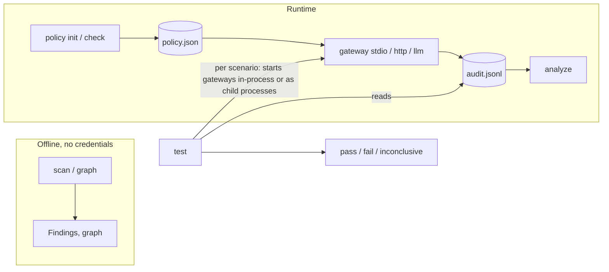

# Groot design

Groot is security and resilience testing for AI agents, in CI. It answers two questions: if this agent is attacked or its tools fail, does it behave safely, and what could it reach if it didn't?

There is one design document per command. Each has a use case, a design diagram, the data flow, and a code trace that follows a real invocation through the source.

| Command | What it does | Doc |
| --- | --- | --- |
| `groot test` | Runs the agent's own tests under injected faults and attacks, and judges the audit log | [test.md](test.md) |
| `groot scan` | Offline blast-radius scan of agents, MCP configs, Kubernetes and IAM snapshots | [scan.md](scan.md) |
| `groot graph` | Mermaid graph of every agent's reach (a `scan` with a fixed format) | [graph.md](graph.md) |
| `groot gateway stdio` | Policy, chaos and audit proxy in front of a stdio MCP server | [gateway-stdio.md](gateway-stdio.md) |
| `groot gateway http` | The same, for Streamable HTTP MCP servers | [gateway-http.md](gateway-http.md) |
| `groot gateway llm` | Drop-in proxy for the Anthropic and OpenAI APIs | [gateway-llm.md](gateway-llm.md) |
| `groot analyze` | Turns an audit log into reliability and safety issues | [analyze.md](analyze.md) |
| `groot policy init\|check` | Writes and validates policy files | [policy.md](policy.md) |

## How the commands fit together

`test` is the product. It drives the gateways, then reuses `analyze` on the audit log they wrote. `scan` is independent and works on files only.

## Entry point

Every command is dispatched from `run` in `cmd/groot/main.go:44`.

| Argument | Handler | Location |
| --- | --- | --- |
| `scan` | `scan(args, …, "")` | `cmd/groot/main.go:98` |
| `graph` | `scan(args, …, "mermaid")` | `cmd/groot/main.go:98` |
| `test` | `testCmd` | `cmd/groot/test.go:25` |
| `gateway` | `gatewayCmd` | `cmd/groot/main.go:235` |
| `analyze` | `analyzeCmd` | `cmd/groot/main.go:340` |
| `policy` | `policyCmd` | `cmd/groot/main.go:384` |

Exit codes are the same everywhere: `0` clean, `1` the command found a problem (scan finding at or above `--fail-on`, failed scenario, critical or high analyze issue), `2` usage or input error.

## Shared building blocks

| Package | Role | Used by |
| --- | --- | --- |
| `internal/capability` | Capability classes (admin, exec, destroy, secrets, write, external, untrusted, read) and `ClassifyTool` on tool names | scan, gateway, analyze |
| `internal/policy` | Policy file, `Decide`, rate limits, model allowlist and budgets | gateway, test |
| `internal/chaos` | Seeded fault injection (`Pick`) | gateway, test |
| `internal/attack` | Prompt-injection payloads and the canary | gateway, test |
| `internal/audit` | JSONL events, `Write`, `Read`, `Redact` | gateway, analyze, test |
| `internal/mcp` | JSON-RPC message parsing and replies | gateway |

Because the capability model is shared, a tool the scanner calls "destroy" is the tool the default policy denies and the tool the analyzer treats as a side effect.

### Capability classes

| Class | Meaning | Examples |
| --- | --- | --- |
| admin | change permissions or become someone else | `*`, `iam:PassRole`, `sts:AssumeRole`, RBAC `bind`/`escalate`/`impersonate` |
| exec | run arbitrary code | shell MCP servers, `pods/exec`, `ssm:SendCommand` |
| destroy | delete data or infrastructure | `*:Delete*`, `ec2:TerminateInstances` |
| secrets | read credentials | `secretsmanager:GetSecretValue`, Kubernetes `secrets` get/list |
| write | create or modify data | `s3:PutObject`, filesystem or GitHub write tools |
| external | send data outside | Slack, email, web requests |
| untrusted | read attacker-controllable content | web fetch, browsers, inbound email |
| read | read private data | `s3:GetObject`, database query tools |

### Audit event types

`tool_call`, `tool_result`, `tool_flagged`, `tool_changed`, `rejected`, `llm_call`, `attack_injected` (`internal/audit/audit.go:15-22`). Decisions: `forwarded`, `denied`, `would_deny`, `pending_approval`, `rate_limited`, `kill_switch`, `fault_injected`, `budget_exceeded`, `model_denied` (`audit.go:27-35`).

## Goals and non-goals

Goals: show every path from an agent to a dangerous capability; enforce least privilege at the tool layer without changing agent code; find unsafe agent behaviour under failure before release; run anywhere, including air-gapped CI, without credentials.

Non-goals for now: prompt-injection classifiers, jailbreak testing, content moderation, live cloud API access, clouds other than AWS, runtimes other than Kubernetes.

## Security of Groot itself

- No credentials: scan reads files; the gateways hold no secrets unless `--inject-keys` is set.
- Fail closed: invalid policies stop startup, JSON-RPC batches are rejected in enforce mode, the kill switch beats every rule.
- No secret leakage: secrets found in configs are redacted in findings; sensitive argument keys are redacted in the audit log.
- Standard library only: the supply chain is the Go toolchain.
- Bounded resources: file and message size caps; token-bucket rate limits.

## Alternatives considered

- **SDK middleware per framework** instead of a proxy: deeper context, but one integration per framework and language. A proxy works for every MCP client.
- **Live API discovery** instead of snapshots: always current, but needs credentials and a security review. Snapshots remove that barrier.
- **LLM-based risk judgment**: non-deterministic findings in a security gate erode trust. Deterministic rules decide.
- **Building on an existing gateway** (Kong, Envoy AI Gateway, LiteLLM): faster start, but the value is the blast-radius graph feeding enforcement, which needs control of both.

## Open questions

- How should approvals reach humans first: Slack, a local CLI queue, or the agent framework's own interrupt mechanism?
- How far to go on IAM fidelity before relying on AWS's policy simulator through opt-in collectors?
- Which agent platforms to support as identity sources next?
