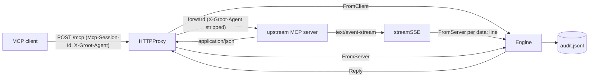

# groot gateway http

```
groot gateway http --policy p.json --upstream URL [--listen 127.0.0.1:8787] [--agent name] [--server-name name] [--audit file] [--env dev] [--chaos]
```

## Use case

The MCP server is remote and speaks Streamable HTTP (a hosted GitHub or Slack server, an internal tools service). The team points the agent's MCP client at `http://127.0.0.1:8787/mcp` instead of the real URL and gets the same policy, chaos and audit as the stdio gateway.

One gateway can serve several agents: each request may carry `X-Groot-Agent`, which overrides `--agent` for rule matching and audit. `groot test` starts this proxy in-process, on a random port, for every URL server in the suite.

## Design



The engine is the one described in [gateway-stdio.md](gateway-stdio.md) (same decision order, tools/list checks and audit events). The HTTP transport adds:

- **Sessions.** Requests and responses are matched by the request's `Mcp-Session-Id` header plus the JSON-RPC ID. For `initialize` there is no session yet, and the request's key (empty session) is kept even if the server assigns an ID in that response.
- **Blocked calls never leave the gateway.** The engine's `Reply` is written as a `200 application/json` response, echoing the session header.
- **Response rewriting.** JSON bodies are passed through `FromServer` whole. Server-sent events are rewritten line by line: each `data:` line goes through `FromServer`, and the stream is flushed at each event boundary. Other content types are copied unchanged.
- **Delays** (latency or timeout faults) sleep before answering, and stop early if the client disconnects.
- **Limits.** Request bodies are capped at `MaxMessage` (413 above it); responses are read up to the same cap.

## Data flow

| Step | Input | Output |
| --- | --- | --- |
| Read request | POST body, `Mcp-Session-Id`, `X-Groot-Agent` | raw JSON-RPC message |
| Decide | message | `Outcome` (`Forward`, `Reply`, `Delay`); `tool_call` event |
| Forward | `Outcome.Forward` | upstream request with copied headers, query string kept |
| Rewrite | upstream JSON or SSE | possibly modified message; `tool_result`, `tool_flagged`, `tool_changed`, `attack_injected` events |
| Respond | rewritten body | client response with upstream status and headers |

GET and DELETE requests (SSE stream open, session close) are proxied without inspection.

## Code trace

Following `POST /mcp` with a `tools/call` through `groot gateway http --policy p.json --upstream https://tools.example/mcp`.

| # | Step | Location |
| --- | --- | --- |
| 1 | `gatewayCmd` with `args[0] == "http"`; flags `--upstream`, `--listen` | `cmd/groot/main.go:235-252` |
| 2 | `--upstream` required and must have scheme and host; server name defaults to its hostname | `cmd/groot/main.go:274-285` |
| 3 | `gatewayFlags.engine` loads policy, audit, chaos, attacks (same as stdio) | `cmd/groot/main.go:179`, `:286` |
| 4 | `http.Server` with `HTTPProxy{Engine, Upstream}` and a 10 s header timeout; graceful shutdown on signal | `cmd/groot/main.go:292-299` |
| 5 | `ListenAndServe` | `cmd/groot/main.go:300` |
| 6 | `HTTPProxy.ServeHTTP`: session and agent headers read; body read through `MaxBytesReader` | `internal/gateway/http.go:30-40`, `:15` |
| 7 | `Engine.FromClient(session, agent, body)` runs the decision chain | `internal/gateway/http.go:41`, `internal/gateway/engine.go:75`, `:106` |
| 8 | `Delay` honoured with `time.After`, cancelled with the request context | `internal/gateway/http.go:42-48` |
| 9 | No `Forward`: write `Reply` as JSON with the session header and return | `internal/gateway/http.go:49-57` |
| 10 | Build the upstream request, copy headers, drop `X-Groot-Agent`, send | `internal/gateway/http.go:61-78`, `:138` |
| 11 | Copy response headers | `internal/gateway/http.go:82` |
| 12a | `text/event-stream`: `streamSSE` rewrites each `data:` line through `FromServer`, flushes per event | `internal/gateway/http.go:86-88`, `:106` |
| 12b | `application/json`: whole body through `FromServer` | `internal/gateway/http.go:89-97`, `internal/gateway/engine.go:203` |
| 12c | Other types: `io.Copy` | `internal/gateway/http.go:98-100` |

## Failure modes

| Situation | Behaviour |
| --- | --- |
| Missing or malformed `--upstream` | exit 2 |
| Request body above the cap | 413 |
| Upstream unreachable | 502 `upstream: …` |
| Client disconnects during an injected delay | request dropped, nothing forwarded |
| Listen error | exit 1 |
