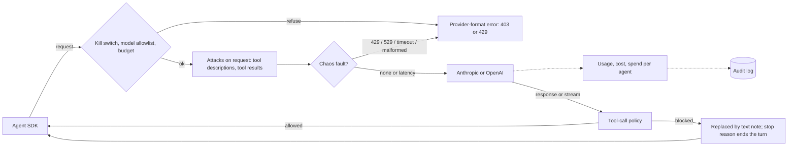

# groot gateway llm

```
groot gateway llm --policy p.json [--listen 127.0.0.1:8788] [--agent name] [--audit file] [--env dev]
                  [--anthropic-url URL] [--openai-url URL] [--inject-keys] [--chaos]
```

## Use case

Many agents never speak MCP: they use provider function calling, and the agent runs its own tools. The MCP gateways cannot see those calls. The LLM gateway sits between the agent's SDK and the model API instead:

```
ANTHROPIC_BASE_URL=http://127.0.0.1:8788
OPENAI_BASE_URL=http://127.0.0.1:8788/v1
```

It then enforces the same tool policy on the tool calls the model returns, caps spend per agent, restricts which models may be used, injects provider faults (429, 529, timeouts), and meters tokens and cost into the audit log. `groot test` starts it in-process when the suite has an `llm` section.

## Design



Decisions:

- **Routes.** `POST /v1/messages` is Anthropic; `POST /v1/chat/completions` (or `/chat/completions`) is OpenAI-compatible. Errors are written in the provider's own error format so SDK retry logic behaves normally.
- **Credentials.** By default the caller's `x-api-key` or `Authorization` header is forwarded, so the gateway holds no secrets. `--inject-keys` replaces them with this process's `ANTHROPIC_API_KEY` / `OPENAI_API_KEY`.
- **Budgets** are per agent (first matching glob) for the life of the process. `max_tokens` / `max_completion_tokens` is lowered so the worst-case cost fits what is left. Under a budget, an unpriced model is refused rather than run unmetered. Concurrent calls can overshoot by at most one call's worst case.
- **OpenAI streams** get `stream_options.include_usage: true` so the call can be metered.
- **Tool calls, non-streaming.** Each `tool_use` block or `tool_calls` entry is decided by the policy, with server name `llm:anthropic` or `llm:openai`. Blocked calls become a text note; if none remain, `stop_reason` becomes `end_turn` (Anthropic) or `finish_reason` becomes `stop` (OpenAI), so the agent does not try to run a tool that was removed.
- **Tool calls, streaming.** Anthropic: a `tool_use` block is held from `content_block_start` to `content_block_stop`, its `input_json_delta` fragments assembled, then released byte for byte or replaced by a text block at the same index. OpenAI: chunks are held from the first `tool_calls` delta to the `finish_reason` chunk. Text is never held.
- **Attacks** are applied to the request: tool descriptions in `tools`, and tool results matched to their tool through earlier `tool_use` / `tool_calls` IDs. Because each request carries the whole conversation, an injected result stays injected on later turns, as a real poisoned document would.
- **Ported from zoko.** The passthrough flow, price table, `fitOutputTokens` and usage parsing come from zoko's gateway, rewritten on `encoding/json` to keep Groot dependency-free.

Limits: the agent runs tools itself, so there is no tool result to observe. Duplicate-side-effect detection needs the MCP gateway. Approvals only hold the call; the agent sees the note.

## Data flow

| Stage | Input | Output | Audit |
| --- | --- | --- | --- |
| Route and parse | path, body (size capped) | provider, model, `stream` flag | none |
| Pre-checks | kill switch, `llm.models`, `llm.budgets` | refusal or a (possibly capped) request | `llm_call` with `kill_switch`, `model_denied` or `budget_exceeded` |
| Attacks | request document | modified `tools` / tool results | `attack_injected` |
| Chaos | `provider/model` ref | fault response or delay | `llm_call` with `fault_injected` |
| Forward | request, allowlisted headers, credentials | upstream response | none |
| Rewrite | JSON body or SSE stream | tool calls kept or replaced by notes | `tool_call` per tool call |
| Meter | usage from body or stream | tokens, cost, agent spend | `llm_call` (`forwarded`, status, latency, tokens, `cost_usd`) |

## Code trace

Following a non-streaming `POST /v1/messages` whose response contains a `tool_use` for `send_email`.

| # | Step | Location |
| --- | --- | --- |
| 1 | `gatewayCmd` sees `args[0] == "llm"` and calls `llmCmd` | `cmd/groot/main.go:236-238` |
| 2 | Flags; `--policy` required; `policy.Load`, `llm.LoadPrices` | `cmd/groot/llm.go:26-54`, `internal/llm/pricing.go:61` |
| 3 | Audit writer; upstream map; `--inject-keys` copies env keys into upstreams | `cmd/groot/llm.go:55-75` |
| 4 | `llm.Proxy` with `KillStat = os.Stat`; chaos from the policy | `cmd/groot/llm.go:76-90` |
| 5 | `http.Server` with the proxy as handler; graceful shutdown | `cmd/groot/llm.go:92-106` |
| 6 | `Proxy.ServeHTTP`: route to provider, POST only, upstream configured, agent from `X-Groot-Agent` | `internal/llm/proxy.go:80-103` |
| 7 | Body read (capped) and decoded; `model`, `stream`, `ref = provider/model` | `internal/llm/proxy.go:104-119` |
| 8 | Kill switch | `internal/llm/proxy.go:127-131` |
| 9 | Model allowlist: `Policy.ModelAllowed` | `internal/llm/proxy.go:132-139`, `internal/policy/policy.go:198` |
| 10 | Budget: `BudgetFor`, `Spent`, `Prices.Lookup`, `fitOutputTokens` lowers `max_tokens` | `internal/llm/proxy.go:140-171`, `internal/policy/policy.go:211`, `internal/llm/pricing.go:108` |
| 11 | OpenAI streams get `include_usage` | `internal/llm/proxy.go:172-183` |
| 12 | `applyAttacks` edits tools and tool results, audited | `internal/llm/proxy.go:184-188`, `internal/llm/attacks.go:14`, `:24`, `:52` |
| 13 | `chaos.Pick(agent, ref)`: 429 with `retry-after`, 529/503, timeout (504), malformed body, or latency | `internal/llm/proxy.go:190-222` |
| 14 | Build the upstream request, allowlisted headers, credentials, default `anthropic-version` | `internal/llm/proxy.go:224-250` |
| 15 | Send; copy allowlisted response headers | `internal/llm/proxy.go:252-268` |
| 16 | `decider` wraps `Policy.Decide` per tool call and writes a `tool_call` event | `internal/llm/proxy.go:272`, `:319-347` |
| 17 | Non-streaming: `readUsage`, then `rewriteAnthropic` replaces the blocked `send_email` with a note and sets `end_turn` | `internal/llm/proxy.go:283-297`, `internal/llm/usage.go:10`, `internal/llm/toolcalls.go:46` |
| 17' | Streaming: `pipeSSE` feeds events to `anthropicStream.push` / `release` (or `openAIStream`) | `internal/llm/proxy.go:276-282`, `:350`, `internal/llm/toolcalls.go:196`, `:236`, `:301` |
| 18 | Status, model, latency, tokens; `Price.Cost` and `addSpend`; final `llm_call` event | `internal/llm/proxy.go:299-313`, `internal/llm/pricing.go:96` |

## Failure modes

| Situation | Provider-format response |
| --- | --- |
| Unknown path | 404 |
| Not POST | 405 |
| Provider upstream not configured | 503 |
| Body too large or not a JSON object | 413 / 400 |
| Kill switch on, model not allowed, unpriced model under a budget | 403 |
| Budget used up or not enough left for one call | 429 |
| Upstream unreachable | 502, audited as `upstream_error` |
| Upstream error status | passed through unchanged |
