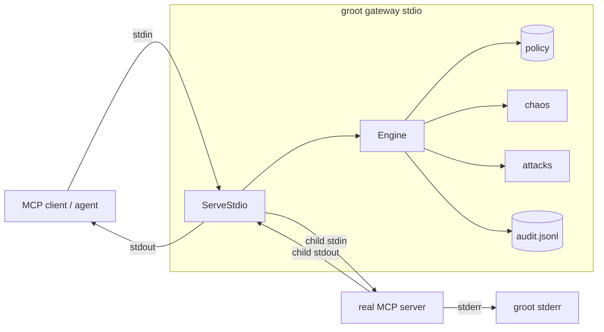
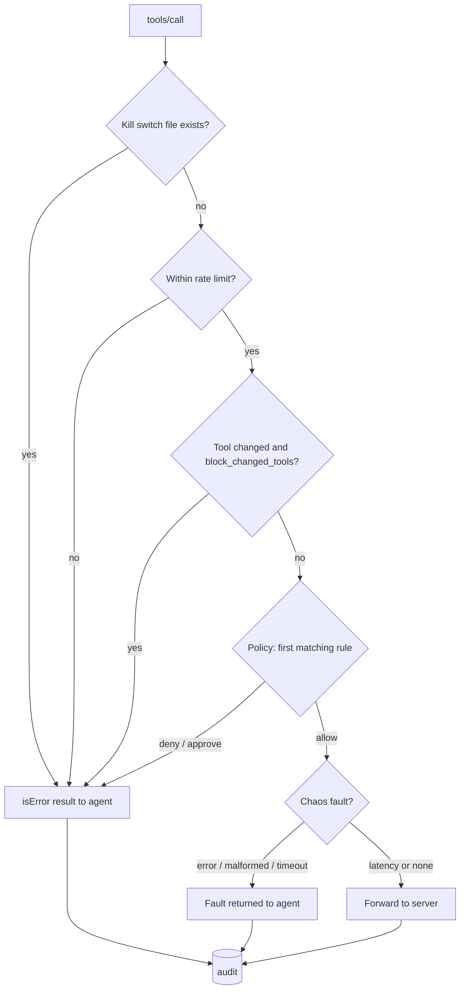

# groot gateway stdio

```
groot gateway stdio --policy p.json [--agent name] [--server-name name] [--audit file] [--env dev] [--chaos] -- <server command...>
```

## Use case

An agent talks to a local MCP server over stdin/stdout (filesystem, shell, database, GitHub). The team wants that server's tools to follow a policy (no `delete_*`, read-only SQL, outbound sends held for a human), with every call audited, and without changing the agent.

They replace the server command in the MCP client config:

```json
{ "mcpServers": { "db": { "command": "groot",
  "args": ["gateway", "stdio", "--policy", "policy.json", "--agent", "support-bot", "--", "npx", "@acme/db-mcp@1.4.0"] } } }
```

The client starts `groot`, `groot` starts the real server as a child, and every JSON-RPC line passes through the gateway engine. `groot test` uses the same wrapper to inject faults and attacks into stdio servers.

## Design



The engine is shared with the HTTP gateway; only the transport differs. Two goroutines relay lines:

- **Client to server.** Each line goes through `Engine.FromClient`, which returns an `Outcome`: `Forward` (send to server), `Reply` (answer the client directly, e.g. a blocked call), and an optional `Delay`. Delayed outcomes run in their own goroutine so one slow call never blocks the stream. The server's stdin closes only after every delayed message lands.
- **Server to client.** Each line goes through `Engine.FromServer`, which records results, inspects `tools/list`, and applies attacks.

### tools/call decision order



In dry-run mode, rate-limit and policy decisions are recorded as `would_deny` and the call is forwarded. The kill switch is enforced in every mode. JSON-RPC batches are rejected in enforce mode and forwarded in dry-run.

### tools/list inspection

On every `tools/list` response, per tool:

1. **Flag injection** (`flag_injection`): description and input schema are matched against patterns ("ignore previous instructions", `<IMPORTANT>`, credential paths, hidden Unicode and so on). Flagged tools are audited and optionally hidden (`hide_flagged`).
2. **Detect changes** (`alert_on_change`): SHA-256 of description plus schema; a change mid-session is audited and can block later calls.
3. **Hide denied** (`hide_denied`): tools a rule always denies are removed, so the model never plans around them.
4. **Attacks** (`groot test` only) are applied after the checks, so Groot never flags its own payload.

## Data flow

| Direction | Message | Engine action | Audit event |
| --- | --- | --- | --- |
| client to server | `tools/list` request | remember request ID | none |
| client to server | `tools/call` | decide, maybe fault, track start time | `tool_call` (decision, rule, fault, redacted args, args hash) |
| client to server | batch | reject (enforce) or forward (dry-run) | `rejected` |
| client to server | anything else | forward unchanged | none |
| server to client | `tools/call` response | latency, error flag, optional `inject_result` | `tool_result`, `attack_injected` |
| server to client | `tools/list` response | flag, hash, hide, optional `poison_tool` / `rug_pull` | `tool_flagged`, `tool_changed`, `attack_injected` |

Argument values under keys that look like passwords, tokens or keys are redacted at any depth; the argument hash is computed on the raw arguments so the analyzer can still compare calls.

## Code trace

Following one `tools/call` for `delete_ticket` through `groot gateway stdio --policy p.json -- ./server`.

| # | Step | Location |
| --- | --- | --- |
| 1 | `run` dispatches `"gateway"` to `gatewayCmd`; `args[0] == "stdio"` | `cmd/groot/main.go:56`, `:235` |
| 2 | Shared flags registered by `gatewayFlags.register` | `cmd/groot/main.go:168` |
| 3 | Signal context; server name defaults to `filepath.Base(cmd[0])` | `cmd/groot/main.go:253-264` |
| 4 | `gatewayFlags.engine`: `policy.Load` (strict decode and `validate`) | `cmd/groot/main.go:179-186`, `internal/policy/policy.go:104`, `:127` |
| 5 | Audit file opened for append (mode 0600) or stderr for `-`; `audit.NewWriter` | `cmd/groot/main.go:187-197`, `internal/audit/audit.go:71` |
| 6 | `gateway.New` builds the engine; `chaos.New` refuses prod env unless `allow_prod` | `cmd/groot/main.go:196-214`, `internal/gateway/engine.go:58`, `internal/chaos/chaos.go:71` |
| 7 | Optional `--attacks` file loaded into `attack.New` | `cmd/groot/main.go:215-229`, `internal/attack/attack.go:75` |
| 8 | `runStdio` starts the child with stdin/stdout pipes; stderr passes through | `cmd/groot/main.go:307-323` |
| 9 | `ServeStdio` starts the client and server goroutines | `internal/gateway/stdio.go:38` |
| 10 | Client goroutine: `readLines` (16 MiB cap) then `Engine.FromClient("", "", line)` | `internal/gateway/stdio.go:53-69`, `:91` |
| 11 | `mcp.Parse`; batch check; `tools/list` IDs remembered; `tools/call` decoded | `internal/gateway/engine.go:75-104`, `internal/mcp/mcp.go:43` |
| 12 | `toolCall` builds the event with `audit.Redact` and `hashArgs` | `internal/gateway/engine.go:106-110`, `:376` |
| 13 | Kill switch: `killStat(KillSwitchFile)` | `internal/gateway/engine.go:118-123` |
| 14 | Rate limit: `RateLimitFor` then token bucket `take` | `internal/gateway/engine.go:124-130`, `:388`, `internal/policy/policy.go:297` |
| 15 | Changed-tool block | `internal/gateway/engine.go:131-137` |
| 16 | `Policy.Decide`: first matching rule (globs plus argument matchers) else `default`. `delete_ticket` matches `delete*` and is denied | `internal/gateway/engine.go:139-159`, `internal/policy/policy.go:226`, `:247` |
| 17 | `block` writes the `tool_call` event and returns `Reply: mcp.ToolResult(id, text, true)` | `internal/gateway/engine.go:111-115`, `internal/mcp/mcp.go:77` |
| 18 | `apply` writes the reply to the client; nothing reaches the server | `internal/gateway/stdio.go:43-50` |
| 19 | For an allowed call: `chaos.Pick` may return error, malformed, timeout (reply) or latency (delayed forward) | `internal/gateway/engine.go:160-184`, `internal/chaos/chaos.go:93` |
| 20 | No fault: `track` records the start time, event written as `forwarded` | `internal/gateway/engine.go:185-190`, `:193` |
| 21 | Server goroutine: `FromServer` matches the pending call, writes `tool_result` with latency | `internal/gateway/stdio.go:75-80`, `internal/gateway/engine.go:203-221` |
| 22 | `inject_result` attack appends text to the result | `internal/gateway/engine.go:222-228`, `:322`, `internal/attack/attack.go:132` |
| 23 | `tools/list` responses go to `filterTools` | `internal/gateway/engine.go:231-235`, `:241` |
| 24 | When the server exits, `runStdio` returns its exit code | `cmd/groot/main.go:324-335` |

## Failure modes

| Situation | Behaviour |
| --- | --- |
| Missing or invalid policy | exit 2 before the server starts |
| `--chaos` with no chaos section | exit 2 |
| Chaos in `prod`, `production`, `prod-*` without `allow_prod` | exit 2 |
| Server fails to start | exit 1 |
| Unparseable line from client | forwarded; the server reports the parse error |
| Server exits | gateway exits with the server's code |
