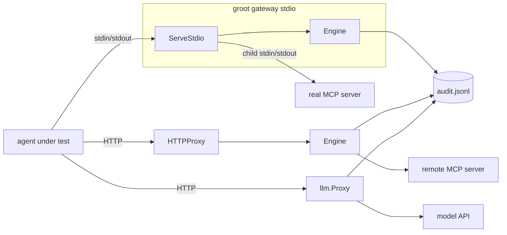
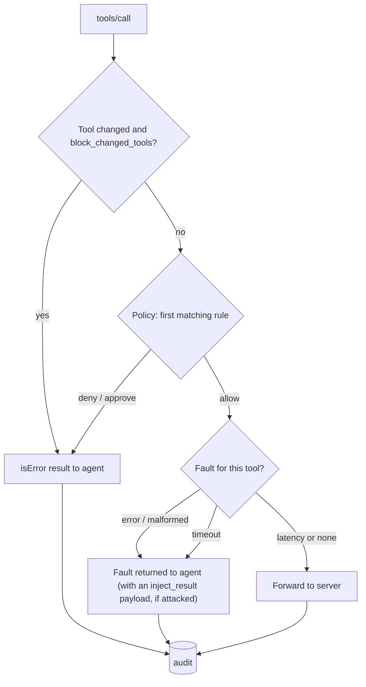

# Test proxies (internal)

`groot test` puts a proxy between the agent and everything it talks to. The proxies apply the scenario's policy, faults and attacks, and write the audit log the verdict is computed from. They exist only inside a test run; they are not a production component.

| Agent talks to | Proxy | How the agent is pointed at it |
| --- | --- | --- |
| a stdio MCP server | `groot gateway stdio … -- <server command>`, a child process | the generated `GROOT_MCP_CONFIG` replaces the server's command |
| a URL (Streamable HTTP) MCP server | `gateway.HTTPProxy`, in-process on a random local port | `GROOT_MCP_CONFIG` points at the local URL |
| the Anthropic or OpenAI API | `llm.Proxy`, in-process on a random local port | `ANTHROPIC_BASE_URL`, `OPENAI_BASE_URL` |

## Design

The MCP engine (`gateway.Engine`) is shared by both MCP transports. For stdio, two goroutines relay lines:

- **Agent to server.** Each line goes through `Engine.FromClient`, which returns an `Outcome`: `Forward` (send to the server), `Reply` (answer the agent directly, for example a blocked or faulted call), and an optional `Delay`. Delayed outcomes run in their own goroutine, so one slow call never blocks the stream.
- **Server to agent.** Each line goes through `Engine.FromServer`, which records results, inspects `tools/list`, and applies attacks.

### tools/call decision order

In `dry-run` mode, policy decisions are recorded as `would_deny` and the call is forwarded. JSON-RPC batches are rejected in `enforce` mode and forwarded in `dry-run`.

### tools/list inspection

On every `tools/list` response, per tool:

1. **Flag injection** (`flag_injection`): the description and input schema are matched against patterns ("ignore previous instructions", `<IMPORTANT>`, credential paths, hidden Unicode and so on). Flagged tools are audited and can be hidden (`hide_flagged`). A real server with a flagged tool fails the scenario.
2. **Detect changes** (`alert_on_change`): SHA-256 of description plus schema; a change mid-session is audited and can block later calls.
3. **Hide denied** (`hide_denied`): tools a rule always denies are removed, so the model never plans around them.
4. **Attacks** (`poison_tool`, `rug_pull`) are applied after the checks, so Groot never flags its own payload.

### Model API proxy

`llm.Proxy` forwards Anthropic Messages and OpenAI Chat Completions requests, streaming or not, and:

- applies the policy to every tool call the model returns; a blocked `tool_use` or `tool_calls` entry is replaced by a text note, and if nothing is left to run the stop reason becomes `end_turn` / `stop`;
- applies attacks to the tools sent to the model (`poison_tool`, `rug_pull`) and to tool results sent back (`inject_result`);
- injects provider faults (`rate_limit` 429 with retry-after, `error` 529/503, `timeout`, `latency`, `malformed`), matched on `provider/model`;
- meters tokens and cost per call, enforces the policy's model allowlist and per-agent budgets (lowering `max_tokens` so the worst case fits what is left);
- forwards the agent's own API key unless the suite sets `inject_keys`.

Prices for Anthropic models are built in; add others with `GROOT_PRICES_FILE` (`{"openai/gpt-5": {"input": 1.25, "output": 10}}`).

## Data flow

| Direction | Message | Engine action | Audit event |
| --- | --- | --- | --- |
| agent to server | `tools/list` request | remember the request ID | none |
| agent to server | `tools/call` | decide, maybe fault, track start time | `tool_call` (decision, rule, fault, redacted args, args hash); `attack_injected` if a fault reply carries a payload |
| agent to server | batch | reject (enforce) or forward (dry-run) | `rejected` |
| agent to server | anything else | forward unchanged | none |
| server to agent | `tools/call` response | latency, error flag, optional `inject_result` | `tool_result`, `attack_injected` |
| server to agent | `tools/list` response | flag, hash, hide, optional `poison_tool` / `rug_pull` | `tool_flagged`, `tool_changed`, `attack_injected` |
| agent to model API | request | allowlist, budget, fault, attacks | `llm_call`, `attack_injected` |
| model API to agent | response | tool-call policy, usage | `tool_call` per model tool call |

Argument values under keys that look like passwords, tokens or keys are redacted at any depth; the argument hash is computed on the raw arguments so the analyzer can still compare calls.

## Where the code lives

| Piece | Code |
| --- | --- |
| Stdio wrapper command | `gatewayCmd`, `gatewayFlags`, `runStdio` in `cmd/groot/main.go` |
| How the runner wires the proxies | `Runner.runScenario` in `internal/suite/run.go` |
| Decision logic | `Engine.FromClient`, `toolCall`, `faultText`, `FromServer`, `filterTools` in `internal/gateway/engine.go` |
| Injection patterns | `InjectionReasons` in `internal/gateway` |
| Transports | `ServeStdio` in `internal/gateway/stdio.go`; `HTTPProxy` in `internal/gateway/http.go` |
| Model API proxy | `Proxy` in `internal/llm/proxy.go`; tool-call rewriting in `toolcalls.go`; attacks in `attacks.go`; pricing and usage in `pricing.go`, `usage.go` |
| Faults | `chaos.New`, `Injector.Pick` in `internal/chaos/chaos.go` |
| Attacks | `attack.New`, `Description`, `Result` in `internal/attack/attack.go` |

## Failure modes

| Situation | Behaviour |
| --- | --- |
| Missing or invalid policy | the wrapper exits 2 before the server starts; the scenario errors |
| Faults with an environment named like production and no `allow_prod` | refused |
| Server fails to start | the wrapper exits 1; the agent sees the server as unavailable |
| Unparseable line from the agent | forwarded; the server reports the parse error |
| Server exits | the wrapper exits with the server's code |
