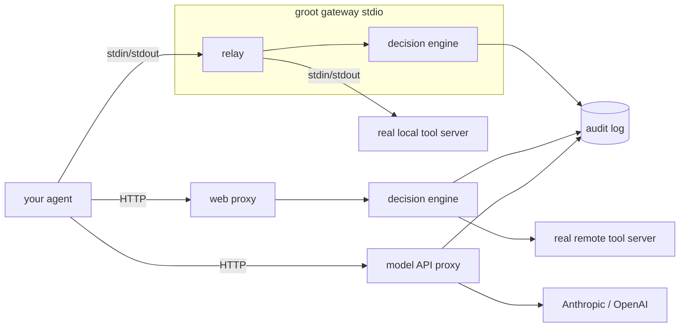
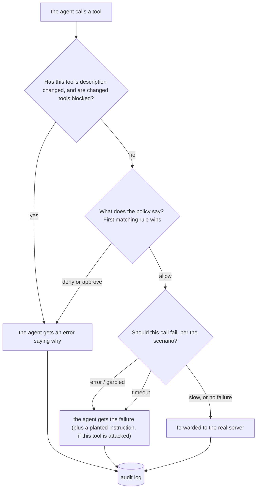

# The go-betweens used during a test

To test an agent without changing it, `groot test` puts a go-between (a proxy) between the agent and everything it talks to. The go-betweens:

- check every call against the scenario's policy;
- make calls fail when the scenario says so;
- plant instructions in what the agent sees;
- write down everything that happens in the audit log, which is what pass or fail is decided from.

They exist only while a test is running. They are not meant to sit in front of a live agent.

| The agent talks to | Go-between | How the agent is pointed at it |
| --- | --- | --- |
| A local MCP tool server (started as a command) | `groot gateway stdio … -- <the server's command>`, run as a separate process | The MCP config Groot writes (`GROOT_MCP_CONFIG`) starts this instead of the server |
| A remote MCP tool server (reached by URL) | A small web proxy inside the `groot test` process, on a random local port | The MCP config points at the local address |
| The Anthropic or OpenAI API | A model API proxy inside the `groot test` process, on a random local port | `ANTHROPIC_BASE_URL` and `OPENAI_BASE_URL` |

## Design

### The MCP go-between

Both MCP go-betweens share one **decision engine** (`gateway.Engine`). Only the way messages arrive differs.

For a local server, Groot starts the real server as a child process and relays lines of text in both directions:

- **From the agent to the server,** each message goes through `Engine.FromClient`. The engine either forwards it to the server, answers the agent directly (for example with "blocked by policy" or a planted failure), or forwards it after a delay. Delayed messages are handled separately, so one slow call never holds up the others.
- **From the server to the agent,** each message goes through `Engine.FromServer`. The engine records the result, checks tool lists, and plants instructions.

### What happens to a tool call

A blocked call comes back to the agent as an ordinary tool error with the reason, so the model can see why and react.

In **dry-run** mode, the policy's decisions are recorded as `would_deny` but the call still goes through. Several requests sent as one batch are refused in enforce mode (Groot inspects calls one at a time) and passed through in dry-run.

### What happens to a tool list

Whenever a server sends its list of tools, the engine looks at each tool in turn:

1. **Look for planted instructions** (`flag_injection`). The description and input format are checked against patterns such as "ignore previous instructions", `<IMPORTANT>`, paths to credential files, and invisible Unicode characters. A match is recorded, and the tool can be hidden (`hide_flagged`). If one of **your own** servers has such a tool, the scenario fails.
2. **Look for changes** (`alert_on_change`). A fingerprint of the description is kept. If it changes during the run, that is recorded and can block later calls to the tool.
3. **Hide forbidden tools** (`hide_denied`). Tools the policy always denies are removed from the list, so the model doesn't plan around them.
4. **Plant attacks** (`poison_tool`, `rug_pull`). This happens after the checks above, so Groot never reports its own planted instruction as a problem with your server.

### The model API go-between

`llm.Proxy` passes Anthropic Messages and OpenAI Chat Completions requests through to the real API, both streaming and non-streaming. On the way it:

- **applies the policy to tool calls the model asks for.** If the model asks to call a forbidden tool, that request is replaced with a short note. If nothing is left to run, the response is marked as finished, so the agent's loop ends cleanly;
- **plants attacks** in the tool descriptions sent to the model (`poison_tool`, `rug_pull`) and in tool results sent back to it (`inject_result`);
- **makes the API fail** as the scenario says: "too many requests" (429 with a retry-after header), "overloaded" (529 or 503), timeouts, slowness, or garbled responses, chosen by `provider/model` pattern;
- **measures tokens and cost** for every call, allows only the models the policy lists, and enforces each agent's spending budget. It lowers `max_tokens` so that even the most expensive answer fits in what is left;
- **passes on the agent's own API key,** unless the suite sets `inject_keys`.

Prices for Anthropic models are built in. For other models, put prices in a file and point `GROOT_PRICES_FILE` at it, for example `{"openai/gpt-5": {"input": 1.25, "output": 10}}` (dollars per million tokens).

## Data flow

| Direction | Message | What the engine does | What goes in the audit log |
| --- | --- | --- | --- |
| Agent to server | Request for the tool list | Remembers the request, to inspect the answer | Nothing |
| Agent to server | A tool call | Decides, maybe applies a failure, starts a timer | `tool_call` (decision, rule, failure, hidden-where-sensitive arguments, argument fingerprint); `attack_injected` if a failure message carries a planted instruction |
| Agent to server | Several requests in one batch | Refuses (enforce) or passes through (dry-run) | `rejected` |
| Agent to server | Anything else | Passes through unchanged | Nothing |
| Server to agent | A tool result | Records the time taken and whether it was an error; maybe plants an instruction | `tool_result`, `attack_injected` |
| Server to agent | The tool list | Flags, fingerprints, hides, maybe poisons | `tool_flagged`, `tool_changed`, `attack_injected` |
| Agent to model API | A request | Checks the model and budget, maybe applies a failure or plants attacks | `llm_call`, `attack_injected` |
| Model API to agent | A response | Applies the policy to requested tool calls; reads token usage | `tool_call` for each tool the model asked for |

Arguments whose names look like passwords, tokens or keys are hidden at any depth. The fingerprint is computed from the full arguments before hiding, so the analysis can still tell whether two calls were identical.

## Where the code lives

| Part | Code |
| --- | --- |
| The `groot gateway stdio` command | `gatewayCmd`, `gatewayFlags`, `runStdio` in `cmd/groot/main.go` |
| How a test sets up the go-betweens | `Runner.runScenario` in `internal/suite/run.go` |
| The decision engine | `Engine.FromClient`, `toolCall`, `faultText`, `FromServer`, `filterTools` in `internal/gateway/engine.go` |
| Patterns for planted instructions | `InjectionReasons` in `internal/gateway/engine.go` |
| Message transport | `ServeStdio` in `internal/gateway/stdio.go`; `HTTPProxy` in `internal/gateway/http.go` |
| The model API go-between | `Proxy` in `internal/llm/proxy.go`; tool-call rewriting in `toolcalls.go`; attacks in `attacks.go`; prices and usage in `pricing.go` and `usage.go` |
| Failures | `chaos.New`, `Injector.Pick` in `internal/chaos/chaos.go` |
| Attacks | `attack.New`, `Description`, `Result` in `internal/attack/attack.go` |

## When things go wrong

| Situation | What happens |
| --- | --- |
| The policy is missing or invalid | The stdio go-between exits with code 2 before starting the server; the scenario shows an error |
| Failures requested in an environment named like production, without `allow_prod` | Refused |
| The real server won't start | The go-between exits with code 1; the agent sees the server as unavailable |
| The agent sends a line that isn't valid JSON | Passed through; the server reports the problem |
| The real server exits | The go-between exits with the server's exit code |
