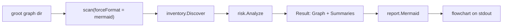

# groot graph

```
groot graph [dir]
```

## Use case

A reviewer wants a picture of what each agent can reach: which service account, which AWS roles, which MCP servers, and which dangerous capabilities sit at the end. `graph` prints a Mermaid diagram that renders in GitHub, GitLab and most wikis, so it can go straight into a pull request or an architecture doc.

`graph` is not a separate engine. It is `scan` with the format forced to Mermaid and the exit-code gate turned off, so it never fails a build.

## Design



Rendering rules (`report.Mermaid`):

- One node per graph node, labelled with the agent, service account, role or MCP server.
- Edges keep their kind (`runs_as`, `irsa`, `assumes`, `uses`, `credentials`).
- Each reachable node gets up to three grant nodes (`class: example (+n)`), most severe first, coloured by severity class; low-value `read` grants are dropped when something stronger exists.
- Labels are shortened and escaped so Mermaid syntax is never broken by resource names.

## Data flow

| Stage | Input | Output |
| --- | --- | --- |
| Discover | directory | `Inventory` |
| Analyze | `Inventory` | `risk.Result` with `Graph` and `Summaries` |
| Render | `Result` | Mermaid text on stdout |

Findings are computed but not printed or used for the exit code.

## Code trace

| # | Step | Location |
| --- | --- | --- |
| 1 | `run` matches `"graph"` and calls `scan(args[1:], …, "mermaid")` | `cmd/groot/main.go:44`, `:52` |
| 2 | In `scan`, `forceFormat != ""` sets `*format = "mermaid"` and `*failOn = "none"` | `cmd/groot/main.go:106-108` |
| 3 | `inventory.Discover(root)` then `risk.Analyze(inv)` | `cmd/groot/main.go:122-130`, `internal/inventory/inventory.go:72`, `internal/risk/risk.go:144` |
| 4 | The `format` switch reaches `report.Mermaid(stdout, res)` | `cmd/groot/main.go:132-146`, `internal/report/report.go:175` |
| 5 | Helpers: `label`, `kindClass`, `classFor` choose labels and CSS classes; `shorten`, `escape` sanitize text | `internal/report/report.go:232`, `:234`, `:241`, `:256`, `:263` |
| 6 | `failOn == "none"` skips the exit-code loop, so the command returns `0` | `cmd/groot/main.go:149` |

See [scan.md](scan.md) for the internals of step 3.

## Failure modes

Same as `scan`: unreadable snapshots are warnings on stderr; an empty directory produces an empty diagram.
