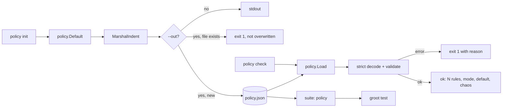

# groot policy

```
groot policy init [--out policy.json]
groot policy check policy.json
```

## Use case

A policy is the permission boundary `groot test` runs the agent inside: which tools it may call, with which arguments, and which calls need a human. A test then shows two things: whether the agent tried to cross the boundary (an injected instruction, an escalation after failure), and whether the boundary held (the call was denied or held, so the injection was *contained*).

A team writes one with `groot policy init --out groot-policy.json`, edits the rules for their tools, and names it as the suite's `policy`. `groot policy check` validates the file in CI with the same loader the test runner uses.

## Design



### Policy file

| Field | Meaning |
| --- | --- |
| `version` | must be `1` |
| `mode` | `enforce` (default): blocked calls are refused. `dry-run`: blocked calls are recorded as `would_deny` and forwarded, to see what a boundary would catch without changing the run |
| `default` | action when no rule matches: `allow` (default), `deny`, `approve` |
| `rules[]` | `name`, `agent`/`server`/`tool` globs, `args` matchers (`equals`, `prefix`, `match`, `not_match`), `action`, `reason` |
| `tool_checks` | `hide_denied`, `flag_injection`, `hide_flagged`, `alert_on_change`, `block_changed_tools` |
| `chaos` | normally written by `groot test` from the scenario's faults: `enabled`, `seed`, `allow_prod`, `faults[]` |
| `llm` | `models` allowlist of `provider/model` globs, `budgets[]` (`agent` glob, `usd`) for model calls |

Evaluation: the first matching rule wins, otherwise `default`. Non-string arguments are matched on their JSON form. `approve` holds the call and tells the model not to retry; in a test, a held call counts as blocked.

Validation is strict on purpose: unknown keys, a wrong version, bad actions, bad globs, bad regexes, non-positive budgets and invalid chaos sections are all errors. A test never runs against a boundary it cannot apply.

### Default policy

`groot policy init` writes:

- `mode: enforce`, `default: allow`
- deny `*exec*`, `*shell*`, `delete*`, `drop*`, `remove*`
- `*query*` allowed only when `sql` does not match `drop|delete|truncate|update|insert|alter|grant`; otherwise denied
- approve `send*`, `*post_message*`, `merge*`
- tool checks: `hide_denied`, `flag_injection`, `alert_on_change`

## Data flow

| Command | Input | Output |
| --- | --- | --- |
| `init` | none | default policy JSON on stdout, or a new file (mode 0644) plus a note on stderr |
| `check` | policy file | `ok: <n> rules, mode <m>, default <d>, <chaos note>` on stdout, or the validation error on stderr |

## Where the code lives

| Step | Code |
| --- | --- |
| Commands | `policyCmd` in `cmd/groot/main.go` |
| Default policy | `Default` in `internal/policy/policy.go` |
| Loading and validation | `Load`, `Parse`, `validate` |
| Decisions at test time | `Decide`, `AlwaysDenied`, `ModelAllowed`, `BudgetFor`; called by the proxies ([gateway.md](gateway.md)) |

## Failure modes

| Situation | Behaviour |
| --- | --- |
| `policy` with no subcommand, or an unknown one | usage, exit 2 |
| `init --out` to an existing file | exit 1, file untouched |
| `check` with a wrong number of arguments | exit 2 |
| `check` on an invalid policy | error on stderr, exit 1 |
