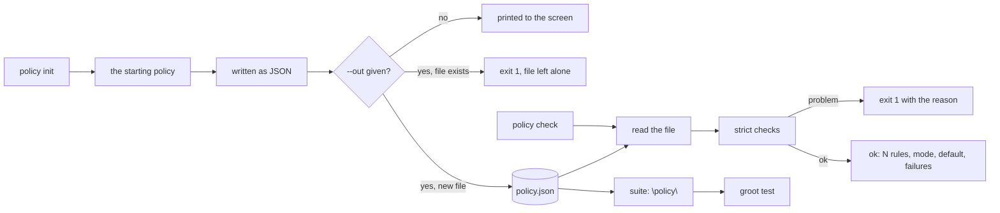

# groot policy

```
groot policy init [--out policy.json]
groot policy check policy.json
```

## Use case

A **policy** is the permission boundary `groot test` runs the agent inside. It lists which tools the agent may call, with which arguments, and which calls must wait for a human's approval.

A test with a policy tells you two different things:

1. **Did the agent try to step outside the boundary?** For example, it obeyed a planted instruction to delete an order, or it switched to raw SQL after the refund tool failed.
2. **Did the boundary hold?** For example, the policy denied `delete_order`, so nothing was deleted. Groot calls this **contained**.

Both matter. An agent that is easily fooled but well fenced in is a different risk from one that is easily fooled and can do anything.

**Typical use.** Run `groot policy init --out groot-policy.json` to get a sensible starting point. Edit the rules for your own tools. Name the file as the `policy` in your suite. In CI, run `groot policy check groot-policy.json` to catch mistakes in the file early. It uses exactly the same checks as `groot test`.

## Design



### The policy file

| Field | What it means |
| --- | --- |
| `version` | Must be `1`. |
| `mode` | `enforce` (the default): calls the policy blocks are refused. `dry-run`: blocked calls are recorded as `would_deny` but still go through. Use dry-run to see what a policy would catch without changing how the run goes. |
| `default` | What happens when no rule matches: `allow` (the default), `deny`, or `approve`. |
| `rules` | A list of rules. Each has a `name`; optional patterns for `agent`, `server` and `tool` (such as `delete_*`); optional argument checks; an `action` (`allow`, `deny` or `approve`); and a `reason` shown to the agent when it is blocked. |
| `tool_checks` | Checks on the list of tools each server offers. `hide_denied` removes tools a rule always denies, so the model doesn't plan around them. `flag_injection` flags descriptions that look like planted instructions, and `hide_flagged` also removes them. `alert_on_change` records a tool whose description changes during the run, and `block_changed_tools` also blocks calls to it. |
| `chaos` | Normally written by `groot test` from the scenario's `faults`, so you rarely set it yourself. |
| `llm` | For agents that call model APIs directly: `models`, a list of allowed models such as `anthropic/claude-*`; and `budgets`, a spending limit in dollars per agent. |

**Argument checks** let a rule look inside a call. Each argument can be checked with `equals`, `prefix`, `match` (a regular expression it must match) or `not_match` (one it must not match). For example: allow `query` only when its `sql` argument doesn't match `delete|drop|update`. Arguments that aren't text are checked using their JSON form.

**How rules are applied.** Rules are checked from top to bottom, and the first one that matches decides. If none match, `default` decides. `approve` holds the call and tells the model not to retry. In a test, a held call counts as blocked.

**Strict checking.** A policy with an unknown field, the wrong version, an unknown action, a bad pattern, a bad regular expression, a budget that isn't positive, or an invalid failure section is rejected. A test never runs against a boundary that can't be applied as written.

### The starting policy

`groot policy init` writes:

- `mode: enforce`, `default: allow`;
- deny tools whose names look like running code or deleting: `*exec*`, `*shell*`, `delete*`, `drop*`, `remove*`;
- allow `*query*` tools only when the `sql` argument doesn't contain `drop`, `delete`, `truncate`, `update`, `insert`, `alter` or `grant`; deny them otherwise;
- hold `send*`, `*post_message*` and `merge*` for approval;
- tool checks: `hide_denied`, `flag_injection`, `alert_on_change`.

## Data flow

| Command | Takes | Produces |
| --- | --- | --- |
| `init` | Nothing | The starting policy as JSON on the screen, or written to a new file with a note on how to use it |
| `check` | A policy file | `ok: <n> rules, mode <m>, default <d>, <note about failures>`, or the reason it was rejected |

## Where the code lives

| Part | Code |
| --- | --- |
| The two commands | `policyCmd` in `cmd/groot/main.go` |
| The starting policy | `Default` in `internal/policy/policy.go` |
| Reading and checking a file | `Load`, `Parse`, `validate` |
| Decisions during a test | `Decide`, `AlwaysDenied`, `ModelAllowed`, `BudgetFor`, called by the go-betweens ([gateway.md](gateway.md)) |

## When things go wrong

| Situation | What happens |
| --- | --- |
| `groot policy` with no subcommand, or an unknown one | Usage is printed; exit 2 |
| `init --out` pointing at a file that already exists | Exit 1; the file is left alone |
| `check` with the wrong number of arguments | Exit 2 |
| `check` on an invalid policy | The reason is printed; exit 1 |
