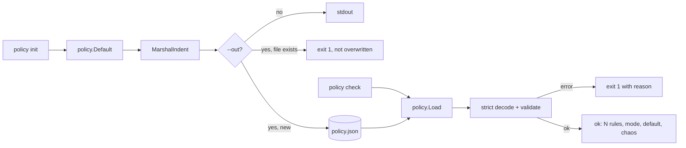

# groot policy

```
groot policy init [--out policy.json]
groot policy check policy.json
```

## Use case

Every gateway needs a policy file. A team adopting Groot runs `groot policy init --out policy.json` to get a safe starting point in dry-run mode, deploys the gateway, reads the `would_deny` events with `groot analyze`, adjusts the rules, then switches `mode` to `enforce`.

`policy check` validates a file in CI before it ships, using the same loader the gateways use, so a policy that passes `check` is one the gateway will start with.

## Design



### Policy file

| Field | Meaning |
| --- | --- |
| `version` | must be `1` |
| `mode` | `enforce` (default) or `dry-run` |
| `default` | action when no rule matches: `allow` (default), `deny`, `approve` |
| `rules[]` | `name`, `agent`/`server`/`tool` globs, `args` matchers (`equals`, `prefix`, `match`, `not_match`), `action`, `reason` |
| `rate_limits[]` | `agent`, `tool` globs and `per_minute` (token bucket) |
| `kill_switch_file` | if this file exists, every call is blocked in every mode |
| `tool_checks` | `hide_denied`, `flag_injection`, `hide_flagged`, `alert_on_change`, `block_changed_tools` |
| `chaos` | `enabled`, `seed`, `allow_prod`, `faults[]` (`type`, `tool`/`agent` globs, `probability`, `delay_ms`, `message`) |
| `llm` | `models` allowlist of `provider/model` globs, `budgets[]` (`agent` glob, `usd`) |

Evaluation: first matching rule wins, otherwise `default`. Non-string arguments are matched on their JSON form. `approve` holds the call and tells the model not to retry; approvals are not yet routed to a human.

Validation is strict on purpose: unknown keys, a wrong version, bad actions, bad globs, bad regexes, non-positive rate limits or budgets, and invalid chaos sections are all errors. The gateway never starts with a policy it cannot enforce.

### Default policy

`groot policy init` writes:

- `mode: dry-run`, `default: allow`
- deny `*exec*`, `*shell*`, `delete*`, `drop*`, `remove*`
- `*query*` allowed only when `sql` does not match `drop|delete|truncate|update|insert|alter|grant`; otherwise denied
- approve `send*`, `*post_message*`, `merge*`
- rate limit 120 calls per minute per tool
- kill switch `/tmp/groot.kill`
- tool checks: `hide_denied`, `flag_injection`, `alert_on_change`

## Data flow

| Command | Input | Output |
| --- | --- | --- |
| `init` | none | default policy JSON on stdout, or a new file (mode 0644) plus a note on stderr |
| `check` | policy file | `ok: <n> rules, mode <m>, default <d>, <chaos note>` on stdout, or the validation error on stderr |

## Code trace

| # | Step | Location |
| --- | --- | --- |
| 1 | `run` dispatches `"policy"` to `policyCmd` | `cmd/groot/main.go:60`, `:384` |
| 2 | `init`: `--out` flag; `policy.Default()` marshalled with indentation | `cmd/groot/main.go:390-398`, `internal/policy/policy.go:309` |
| 3 | No `--out`: write to stdout, exit 0 | `cmd/groot/main.go:399-402` |
| 4 | `--out` exists: refuse, exit 1; else `os.WriteFile` and print the dry-run reminder | `cmd/groot/main.go:403-411` |
| 5 | `check`: exactly one path; `policy.Load` reads the file | `cmd/groot/main.go:413-418`, `internal/policy/policy.go:104` |
| 6 | `Parse`: `json.Decoder` with `DisallowUnknownFields` | `internal/policy/policy.go:114-125` |
| 7 | `validate`: version, mode, default, rule names and actions, globs via `path.Match`, compiled regexes, rate limits, `Chaos.Validate`, LLM globs and budgets | `internal/policy/policy.go:127-195`, `internal/chaos/chaos.go:42` |
| 8 | Summary line with rule count, mode, default and chaos note | `cmd/groot/main.go:423-428` |

At runtime the loaded policy is used through `Decide` (`internal/policy/policy.go:226`), `AlwaysDenied` (`:237`), `RateLimitFor` (`:297`), `ModelAllowed` (`:198`) and `BudgetFor` (`:211`). See the gateway docs for where each is called.

## Failure modes

| Situation | Behaviour |
| --- | --- |
| `policy` with no subcommand, or unknown subcommand | usage, exit 2 |
| `init --out` to an existing file | exit 1, file untouched |
| `check` with a wrong number of arguments | exit 2 |
| `check` on an invalid policy | error on stderr, exit 1 |
