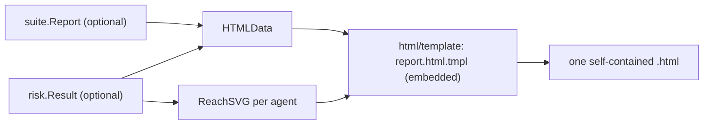

# The HTML report

```
groot test --html report.html [--scan dir] ...
groot scan --format html [dir] > report.html
groot graph [dir] > report.html
```

## Use case

A team lead or security reviewer wants one file that shows how an agent did under attack and failure, what it can reach, and what to fix, without installing anything. The file is attached to the CI run, shared in a pull request, or emailed.

`groot graph` is `scan` with the format forced to HTML and the exit-code gate turned off, so it never fails a build. `groot test --html` writes the same report with the test results on top, and with the reach section when the suite names a scan directory.

## Design



Decisions:

- **Self-contained and script-free.** CSS is inline and the graph is inline SVG laid out in Go. No JavaScript, no fonts or assets from the network, so the file opens anywhere, including air-gapped machines and mail clients, and cannot run code. Hover details use SVG `<title>` elements.
- **Escaped by construction.** Everything goes through `html/template`; the SVG builder escapes every label. Secrets are already redacted upstream.
- **Status colours always carry a label.** Severity and status use a fixed status palette (critical, serious, warning, good, neutral) with the word next to every dot; node kinds use categorical colours and also carry their kind in the label text ("sa …", "role …", "mcp …"). Light and dark values are chosen separately and follow the viewer's system setting.

### Sections

1. **Summary tiles.** Scenarios with a pass/fail bar; failed count; agents scanned; findings by severity with a bar.
2. **Tests** (when present). One card per scenario: status, kind, duration and call counts, each check, the control-run outcome, and the impact of an obeyed injection with paths.
3. **What each agent can reach** (when a scan is present). Per agent: the eight "can it ...?" answers with the evidence for each yes; the reach graph; all permissions as a collapsible table.
4. **Findings.** Per agent, every finding with severity, rule, path, evidence and fix; then the scan notes.

### Reach graph layout

`ReachSVG` (`internal/report/graphsvg.go`) draws a left-to-right tree:

- The tree is the BFS shortest-path tree from the agent (`AgentResult.Reach`): each node's parent is the source of the last edge on its path. Column = path length.
- Each node's capability classes become chips in a final column, most dangerous first, at most four; `read` is dropped when anything stronger exists. Chip colour follows the scan's severity for that class (admin and exec critical; destroy critical on production, else high; secrets, external and untrusted high; write medium).
- Rows are assigned depth first, and a node's own chips take rows before its children's subtrees, so the long dashed edges to the chip column never cross another node.
- Edges carry their kind (`runs_as`, `irsa`, `assumes`, `uses`, `credentials`) as hover text.

`groot scan --format mermaid` still renders the graph as Mermaid for pasting into Markdown.

## Where the code lives

| Piece | Code |
| --- | --- |
| Data and template functions | `HTMLData`, `HTML` in `internal/report/html.go` |
| Template and styles | `internal/report/report.html.tmpl` (embedded) |
| Reach graph | `ReachSVG`, `chipsFor`, `chipSeverity` in `internal/report/graphsvg.go` |
| Wiring | `scan` in `cmd/groot/main.go` (`--format html`, `graph`); `testCmd` and `writeHTML` in `cmd/groot/test.go` (`--html`) |

## Failure modes

| Situation | Behaviour |
| --- | --- |
| `--html` path not writable | exit 2 after the run; the other output is already written |
| Agent with no resolved identities or servers | the card says so instead of drawing a graph |
| Test without a scan | the report has only the test sections |
