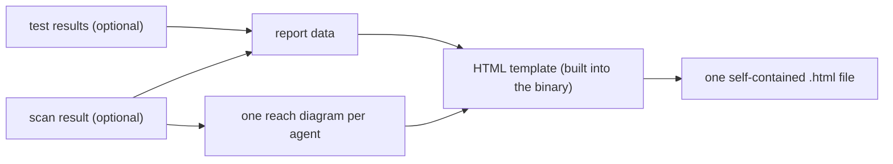

# The HTML report

```
groot test --html report.html [--scan folder] ...
groot scan --format html [folder] > report.html
groot graph [folder] > report.html
```

## Use case

A team lead, a security reviewer or an auditor wants to see, in one place:

- how the agent did when Groot tried to break it;
- what the agent can reach;
- what to fix first.

They don't want to install anything or read terminal output. So Groot writes one HTML file that can be attached to a CI run, linked from a pull request, or emailed, and opened in any browser.

The three commands produce the same kind of report:

- `groot graph` is `groot scan --format html` that never fails the build. Use it when you just want the picture.
- `groot test --html` adds the test results at the top. If the suite has a scan folder, the reach section is included too.

## Design



### Key decisions

- **One file, no scripts, nothing from the internet.** All styles are inside the file, and the diagram is drawn as SVG by Groot itself. There is no JavaScript and no external font or image. The file opens anywhere, including offline machines and email clients, and it can't run code on the reader's machine. Hovering over parts of the diagram shows details using the browser's built-in tooltips.
- **Safe text.** All text goes through Go's `html/template`, which escapes it, and the diagram code escapes every label. Passwords and tokens are already hidden before the report is built.
- **Colour never carries meaning alone.** Severity and status colours always appear next to a word ("critical", "fail"). The colours for kinds of points in the diagram (agent, service account, role, tool server) are backed up by the label text ("sa …", "role …", "mcp …"). This keeps the report readable for colour-blind readers and when printed in black and white.
- **Light and dark mode.** Both colour sets are designed separately, and the report follows the reader's system setting.

### What's in it

1. **Summary tiles** at the top: how many scenarios ran, passed and failed (with a bar); how many failed; how many agents were scanned; and how many findings there are of each severity (with a bar).
2. **Tests** (when present): one card per scenario, with its status, its kind, how long it took and how many calls it made, every check with the reason for any failure, the control-run result, and the impact of any obeyed instruction, including permission paths.
3. **What each agent can reach** (when a scan is present): one card per agent with the eight yes/no answers and evidence for every "yes"; the reach diagram; and every permission in a table you can expand.
4. **Findings:** for each agent, every finding with its severity, rule, path, evidence and suggested fix. Then any notes from the scan, such as the limits of the AWS evaluation.

### How the reach diagram is drawn

The diagram is drawn by `ReachSVG` in `internal/report/graphsvg.go`. It reads left to right:

- **The agent is on the left.** Each column to the right is one more step away. Service accounts, roles and tool servers appear in the column matching how many steps it takes to reach them by the shortest path.
- **Lines show how each point is reached.** Every point has exactly one incoming line, from the step before it on its shortest path, so the diagram is a tree and easy to follow. Hovering a line shows how the link works (`runs_as`, `irsa`, `assumes`, `uses`, `credentials`).
- **On the far right are the powers.** Each service account, role or tool server has up to four boxes on the right, one per kind of power it grants, most dangerous first. Each box shows an example permission and how many more there are. "read" is left out when something stronger is present, to keep the diagram short. The box colour follows the severity of that kind of power: admin and exec critical; destroy critical on production, otherwise high; secrets, external and untrusted high; write medium; read low.
- **No crossing lines.** Rows are assigned from top to bottom, and each point's own power boxes take rows before its children do. So the dashed lines out to the power column never cross another box.

To paste a diagram into Markdown instead, use `groot scan --format mermaid`.

## Where the code lives

| Part | Code |
| --- | --- |
| Report data and helper functions for the template | `HTMLData`, `HTML` in `internal/report/html.go` |
| The template and its styles | `internal/report/report.html.tmpl`, built into the binary |
| The reach diagram | `ReachSVG`, `chipsFor`, `chipSeverity` in `internal/report/graphsvg.go` |
| Hooking it into the commands | `scan` in `cmd/groot/main.go` (`--format html`, `graph`); `testCmd` and `writeHTML` in `cmd/groot/test.go` (`--html`) |

## When things go wrong

| Situation | What happens |
| --- | --- |
| The `--html` file can't be written | Exit 2 after the run. The normal output has already been written. |
| An agent with no identities or tool servers found | Its card says so instead of drawing an empty diagram |
| A test run without a scan | The report contains only the test sections |
