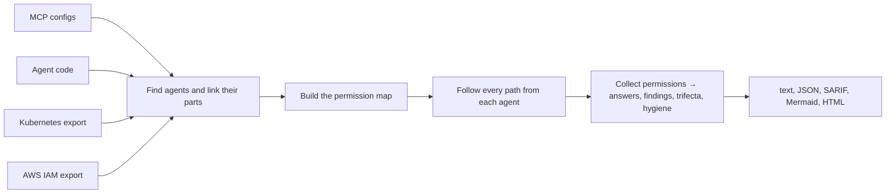

# groot scan

```
groot scan [--format text|json|sarif|mermaid|html] [--fail-on critical|high|medium|low|none] [folder]
```

## Use case

A platform or security engineer wants to know what each AI agent could damage if it were fooled, before the agent handles any real traffic.

The questions they actually ask are simple. Can this agent delete a database? Can it start Lambda functions without limit? Can it delete things in AWS or Kubernetes? Can it read secrets? The answers are hard to find by hand, because permissions are spread across Kubernetes role bindings, AWS policies, roles that can take on other roles, and tool configuration files.

So they export their Kubernetes and AWS permissions to files, put them in a folder with the agent's code, and run `groot scan`. For each agent they get:

- **answers** to those questions, each with the exact permission that makes it true;
- **findings**, one per kind of risk, each with the full chain that creates it, for example `support-bot → sa support/support-bot → role support-agent-role → role ops-admin`;
- **a diagram** of the agent's reach, in the HTML report ([report.md](report.md)).

The scan works **offline**: no cloud credentials and no network. In CI, `--fail-on critical` (the default) fails the build when there is a critical finding, and `--format sarif` sends findings to GitHub code scanning. `groot test` uses the same results to explain how bad an obeyed instruction is.

## Design



The scan works in five steps.

### 1. Find what's in the folder

Groot walks the folder. It skips folders that never hold agents (`.git`, `node_modules`, `vendor`, `.venv`, `venv`, `__pycache__`, `dist`, `build`, `.terraform`, `testdata`) and very large files. It looks for:

- **MCP configs,** recognised by file name. From each it reads every tool server: how the agent connects, which package it runs and whether the version is pinned, any password or token written straight into the file (which it hides in all output), and any AWS role the server uses (`AWS_ROLE_ARN`).
- **Agent code,** recognised by what it imports: LangGraph, LangChain, CrewAI, AutoGen, LlamaIndex, Pydantic AI, the OpenAI Agents SDK, the Vercel AI SDK, Mastra, the provider SDKs, and MCP client libraries.
- **Permission exports,** recognised by their content: any `.json` file that looks like an AWS IAM export or a set of Kubernetes objects. Several Kubernetes exports are merged. Only one IAM export is used.

### 2. Work out which pieces belong to the same agent

1. A folder with agent code (using a model provider or an agent framework, not just an MCP library) is an agent, named after the folder.
2. An MCP config in that folder belongs to that agent. A config at the top of the repository, or in `.cursor/` or `.vscode/`, belongs to an agent called `ide-assistant` (the AI assistant in someone's editor). Any other config starts a new agent named after its folder.
3. A Kubernetes workload is an agent if it has the annotation `groot.dev/agent: "true"`, has a name given by `groot.dev/agent-name`, or has an LLM API key in its environment. It is merged with the code agent of the same name.

### 3. Follow the identities

- **Kubernetes.** From the workload to the service account it runs as (noting whether its token is mounted), then to every role binding that grants that account rights, including bindings to groups such as all service accounts or all signed-in users. If the service account is annotated with an AWS role (`eks.amazonaws.com/role-arn`, which is how IRSA works), the path continues into AWS.
- **AWS.** For each role, its inline and attached policies are checked against a list of about 60 sensitive AWS actions. Wildcards such as `s3:*` are expanded, explicit denies win, and permissions that only apply under a condition are kept but marked as conditional. If a role is allowed to take on another role (and that role trusts it), the path continues to that role, and so on.
- **Tool servers.** Well-known servers (filesystem, GitHub, Slack, databases, web fetch and so on) have profiles that say what kinds of power they give. Unknown servers are reported as unknown, not guessed.

**Not modelled yet,** and stated in every report: organisation-wide restrictions (SCPs), permission boundaries, session policies, and permissions attached to resources (such as S3 bucket policies). The first three can only take access away, so ignoring them can make the scan **overstate** reach. Resource policies can also grant access, for example a bucket policy that lets a role in from outside, so the scan can **miss** that kind of reach.

### 4. Build the map and collect permissions

The map has four kinds of points: agents, tool servers, Kubernetes service accounts and AWS roles. The links between them are "runs as", "IRSA", "can take on" (assume), "uses", and "has credentials for".

Every service account, role and tool server carries its **permissions**. Each permission has a kind of power (see [README.md](README.md)), the permission text, where it comes from (`aws`, `k8s` or `mcp`), and two flags: does it cover production, and is it conditional?

Groot then searches outward from each agent and finds the shortest path to every point it can reach. All permissions on those points become the agent's permissions, each tagged with the point that holds it.

### 5. Answer the questions and raise findings

**The questions.** A fixed list of yes/no questions is checked against the agent's permissions (`risk.Answers`):

| Question | Answered "yes" when the agent has |
| --- | --- |
| Can it delete a database? | AWS `rds:Delete*`, `dynamodb:Delete*` or `rds:ModifyDBInstance`; Kubernetes delete on StatefulSets or volumes; or a database tool server with delete power |
| Can it delete AWS resources? | Any AWS permission of kind destroy |
| Can it delete Kubernetes resources? | Any Kubernetes permission of kind destroy |
| Can it run compute without a cap (Lambda, EC2, ECS, pods)? | `lambda:InvokeFunction`, `lambda:CreateFunction`, `lambda:UpdateFunctionCode`, `ec2:RunInstances`, `ecs:RunTask`; Kubernetes `create pods`, `pods/exec` or `pods/attach` |
| Can it run commands or code? | Any permission of kind exec |
| Can it read secrets? | Any permission of kind secrets |
| Can it give itself more access? | Any permission of kind admin |
| Can it send data outside the company? | Any permission of kind external |

Each answer keeps up to three matching permissions as evidence, notes which identity holds the first one, and says whether any of them covers production.

**Findings.** For each of the five most serious kinds of power (admin, exec, destroy, secrets, write), Groot looks at every point the agent can reach that grants it. It picks the worst one, ranked by severity and then by how many matching permissions it has. That becomes the finding. The others are listed as "also via", so you know that fixing one path doesn't close them all.

| Kind | Severity |
| --- | --- |
| admin, exec | critical |
| destroy | critical if anything looks like production (a name containing `prod` or `production`, a `*` resource, or a role tagged as production); otherwise high |
| secrets | high |
| write | high on production; otherwise medium |
| every matching permission is conditional | one level lower, and marked conditional |

**The lethal trifecta (FL110).** An agent that can read private data, also reads content an attacker can control, and can send data out is critical. One planted instruction is all it takes to make it read the data and send it away. The finding names which tool or identity supplies each of the three.

**Config hygiene.** FL201 for a password or token written into a config file; FL202 for a tool server whose version isn't pinned; FL203 for a remote tool server reached over unencrypted HTTP; FL204 for a tool server Groot doesn't recognise.

## Data flow

| Step | Takes | Produces |
| --- | --- | --- |
| Find | A folder | An inventory: agents, tool servers, the Kubernetes model, the AWS export, warnings |
| Build the map | The inventory | The map, with permissions on each point |
| Evaluate | The map | Per agent: what it reaches, its permissions, kinds of power, answers and findings |
| Output | The result | Text, JSON, SARIF 2.1.0, Mermaid or HTML |
| Exit code | Findings and `--fail-on` | `1` if any finding is at or above the threshold |

## Where the code lives

| Part | Code |
| --- | --- |
| Flags, output and exit code | `scan` in `cmd/groot/main.go`. `groot graph` calls it with format `html` and `--fail-on none`. |
| Walking the folder, recognising exports | `Discover`, `sniffSnapshot` in `internal/inventory/inventory.go` |
| Reading MCP configs, finding secrets, checking pinning | `ParseMCPConfig` in `internal/inventory/mcpconfig.go` |
| Recognising agent code | `detectCode` in `internal/inventory/code.go` |
| Linking pieces into agents | `assemble` in `internal/inventory/inventory.go` |
| Kubernetes rights and IRSA | `internal/identity/k8s` |
| AWS policies and role chains | `internal/identity/aws` |
| The map and the search | `internal/graph/graph.go` |
| Permissions, findings, severities, trifecta, hygiene | `Analyze`, `addAgent`, `addRole`, `addK8sGrants`, `evaluate`, `classSeverity`, `hygiene` in `internal/risk/risk.go` |
| The yes/no questions | `Answers` in `internal/risk/answers.go` |
| Text, JSON, SARIF, Mermaid | `internal/report/report.go` |
| HTML and the reach diagram | `internal/report/html.go`, `internal/report/graphsvg.go` |

## When things go wrong

| Situation | What happens |
| --- | --- |
| An MCP config or export can't be parsed | A warning on screen; the scan carries on |
| A role is mentioned but isn't in the IAM export | A note in the report; that role contributes no permissions |
| An agent uses AWS roles but there is no IAM export | A note in the report telling you how to export one |
| Two IAM exports in the folder | A warning; the first is used |
| An unknown `--format` or `--fail-on` value | Exit 2 |
