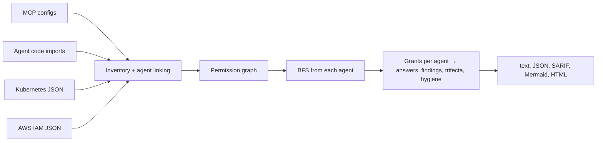

# groot scan

```
groot scan [--format text|json|sarif|mermaid|html] [--fail-on critical|high|medium|low|none] [dir]
```

## Use case

A platform or security engineer wants to know what each AI agent could break if it were tricked, before any traffic exists. Can it delete a database? Run Lambda functions without limit? Delete AWS or Kubernetes resources? They export a Kubernetes snapshot and an IAM snapshot, point `scan` at the directory, and get, per agent:

- answers to those questions, each with the permission that makes it true;
- one finding per risk class with the path that creates it (`support-bot → sa support/support-bot → role support-agent-role → role ops-admin`);
- a reach graph, in the HTML report ([report.md](report.md)).

Offline by design: no cloud credentials, no network. In CI, `--fail-on critical` (the default) fails the build, and `--format sarif` feeds code scanning. `groot test` reuses the same result to explain the impact of an obeyed injection.

## Design



### Inventory

The walker skips `.git`, `node_modules`, `vendor`, `.venv`, `venv`, `__pycache__`, `dist`, `build`, `.terraform`, `testdata` and files over the size cap. It reads:

- **MCP configs** by file name (`mcpServers` and `servers` maps): transport, package and whether its version is pinned, literal secrets (redacted), `AWS_ROLE_ARN`.
- **Agent code** by imports (LangGraph, LangChain, CrewAI, AutoGen, LlamaIndex, Pydantic AI, OpenAI Agents SDK, Vercel AI SDK, Mastra, provider SDKs, MCP client libraries).
- **Snapshots** by sniffing the content of `.json` files: an IAM authorization export, or Kubernetes objects. Several Kubernetes exports merge; only one IAM export is used.

### Linking into agents

1. A directory with agent code (a provider or framework, not just an MCP client library) is an agent named after the directory.
2. An MCP config in that directory belongs to it. A config at the repo root or in `.cursor/`, `.vscode/` belongs to an `ide-assistant`. Otherwise the config's directory names a new agent.
3. A Kubernetes workload is an agent if annotated `groot.dev/agent: "true"`, named via `groot.dev/agent-name`, or carrying an LLM API key variable. It merges with the code agent of the same name.

### Identity resolution

- **Kubernetes**: workload to service account (token mounted or not); RBAC bindings, including the `system:serviceaccounts*` and `system:authenticated` groups; IRSA through the `eks.amazonaws.com/role-arn` annotation.
- **AWS**: inline and attached managed policies tested against a catalogue of about 60 sensitive actions (wildcards resolve), `NotAction`, explicit denies, conditional allows kept and marked, assume-role chains using trust policies.
- **MCP servers**: profiles matched on package, command or URL. Unknown servers are reported, not guessed.

Not modelled, and stated in every report: SCPs, permission boundaries, session policies, resource-based policies.

### Graph, grants and answers

Nodes: agents, MCP servers, service accounts, AWS roles. Edges: `runs_as`, `irsa`, `assumes`, `uses`, `credentials`. Each identity or server node carries grants: a capability class, the permission text, its source (`aws`, `k8s`, `mcp`), and whether it covers production or is conditional.

Breadth-first search from each agent gives the shortest path to every node it can reach. Every grant on those nodes becomes one of the agent's `grants`, tagged with the node that holds it.

**Answers.** A fixed list of questions is evaluated against the agent's grants (`risk.Answers`):

| Question | Matches |
| --- | --- |
| Can it delete a database? | AWS `rds:Delete*`, `dynamodb:Delete*`, `rds:ModifyDBInstance`; Kubernetes delete on StatefulSets, PVCs or PVs; a database MCP server with destroy tools |
| Can it delete AWS resources? | any AWS grant of class destroy |
| Can it delete Kubernetes resources? | any Kubernetes grant of class destroy |
| Can it run compute without a cap (Lambda, EC2, ECS, pods)? | `lambda:InvokeFunction`, `lambda:CreateFunction`, `lambda:UpdateFunctionCode`, `ec2:RunInstances`, `ecs:RunTask`; Kubernetes `create pods`, `pods/exec`, `pods/attach` |
| Can it run commands or code? | any exec grant |
| Can it read secrets? | any secrets grant |
| Can it give itself more access? | any admin grant |
| Can it send data outside the company? | any external grant |

Each answer carries up to three matching permissions, the node that holds the first, and whether any match covers production.

**Findings.** For each risk class (admin, exec, destroy, secrets, write) the candidates from every reachable node are ranked by severity, then by number of grants; the worst becomes the finding and the rest are listed as "also via".

| Class | Severity |
| --- | --- |
| admin, exec | critical |
| destroy | critical if any resource looks like production (`prod`/`production`, `*`, role tag), else high |
| secrets | high |
| write | high on production, else medium |
| all grants conditional | one level lower, marked conditional |

**Lethal trifecta (FL110).** Private data (read, secrets, write, destroy, admin or exec) plus untrusted input plus an external channel is critical, with the supplier of each leg named.

**Config hygiene.** FL201 literal credentials, FL202 unpinned packages, FL203 plain-HTTP remotes, FL204 unknown servers.

## Data flow

| Stage | Input | Output |
| --- | --- | --- |
| Discover | directory tree | `Inventory`: agents, MCP servers, K8s model, AWS snapshot, warnings |
| Build graph | `Inventory` | `graph.Graph` and per-node grants |
| Evaluate | graph, grants | per agent: reach, grants, capabilities, answers, findings |
| Render | `risk.Result` | text, JSON, SARIF 2.1.0, Mermaid or HTML |
| Exit code | findings, `--fail-on` | `1` if any finding is at or above the threshold |

## Where the code lives

| Step | Code |
| --- | --- |
| Flags, rendering, exit code | `scan` in `cmd/groot/main.go` (`graph` calls it with format `html` and `--fail-on none`) |
| Directory walk and snapshot sniffing | `Discover`, `sniffSnapshot` in `internal/inventory/inventory.go` |
| MCP configs, secrets, pinning | `ParseMCPConfig` in `internal/inventory/mcpconfig.go` |
| Agent code detection | `detectCode` in `internal/inventory/code.go` |
| Linking into agents | `assemble` in `internal/inventory/inventory.go` |
| Kubernetes RBAC and IRSA | `internal/identity/k8s` |
| IAM evaluation and role chains | `internal/identity/aws` |
| Graph and BFS | `internal/graph/graph.go` |
| Grants, findings, severities, trifecta, hygiene | `Analyze`, `addAgent`, `addRole`, `addK8sGrants`, `evaluate`, `classSeverity`, `hygiene` in `internal/risk/risk.go` |
| Answers | `Answers` in `internal/risk/answers.go` |
| Text, JSON, SARIF, Mermaid | `internal/report/report.go` |
| HTML and reach graph | `internal/report/html.go`, `internal/report/graphsvg.go` |

## Failure modes

| Situation | Behaviour |
| --- | --- |
| Unparseable MCP config or snapshot | warning on stderr; scan continues |
| Role referenced but missing from the IAM export | note in the report; no grants for that role |
| Agent uses AWS roles but there is no IAM export | note in the report |
| Second IAM snapshot in the tree | warning; the first is used |
| Unknown `--format` or `--fail-on` | exit 2 |
