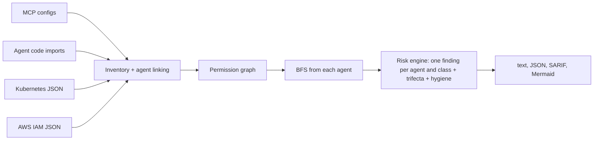
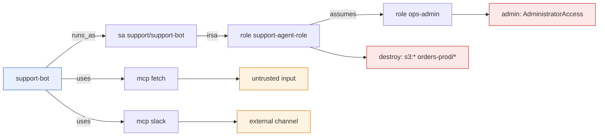

# groot scan

```
groot scan [--format text|json|sarif|mermaid] [--fail-on critical|high|medium|low|none] [dir]
```

## Use case

A platform engineer wants to know what each AI agent in a repo could break if it were tricked, before any traffic exists. They export a Kubernetes snapshot and an IAM snapshot, point `scan` at the directory, and get one finding per agent and risk class, each with the path that creates it (`support-bot → sa support/support-bot → role support-agent-role → s3:* on orders-prod/*`).

Offline by design: no cloud credentials, no network. In CI, `--fail-on critical` (the default) fails the build; `--format sarif` feeds code scanning.

## Design



### Inventory

The walker skips `.git`, `node_modules`, `vendor`, `.venv`, `venv`, `__pycache__`, `dist`, `build`, `.terraform`, `testdata` and files over the size cap. It reads:

- **MCP configs** by file name (`mcpServers` and `servers` maps): transport, package and whether its version is pinned, literal secrets (redacted), `AWS_ROLE_ARN`.
- **Agent code** by imports (LangGraph, LangChain, CrewAI, AutoGen, LlamaIndex, Pydantic AI, OpenAI Agents SDK, Vercel AI SDK, Mastra, provider SDKs, MCP client libraries).
- **Snapshots** by content sniffing of `.json`: an IAM authorization export, or Kubernetes objects. Several Kubernetes exports merge; only one IAM export is used.

### Linking into agents

1. A directory with agent code (a provider or framework, not just an MCP client library) is an agent named after the directory.
2. An MCP config in that directory belongs to it. A config at the repo root or in `.cursor/`, `.vscode/` belongs to an `ide-assistant`. Otherwise the config's directory names a new agent.
3. A Kubernetes workload is an agent if annotated `groot.dev/agent: "true"`, named via `groot.dev/agent-name`, or carrying an LLM API key variable. It merges with the code agent of the same name.

### Identity resolution

- **Kubernetes**: workload to service account (token mounted or not), RBAC bindings (including the `system:serviceaccounts*` and `system:authenticated` groups), IRSA through the `eks.amazonaws.com/role-arn` annotation.
- **AWS**: inline and attached managed policies tested against a catalogue of about 60 sensitive actions (wildcards resolve), `NotAction`, explicit denies, conditional allows kept and marked, assume-role chains using trust policies.
- **MCP servers**: profiles matched on package, command or URL. Unknown servers are reported, not guessed.

Not modelled, and stated in every report: SCPs, permission boundaries, session policies, resource-based policies.

### Graph and findings

Nodes: agents, MCP servers, service accounts, AWS roles. Edges: `runs_as`, `irsa`, `assumes`, `uses`, `credentials`.



Breadth-first search from each agent gives the shortest path to every identity. For each risk class (admin, exec, destroy, secrets, write) the candidates from every identity are ranked by severity, then number of grants; the worst becomes the finding, the rest are listed as "also via".

| Class | Severity |
| --- | --- |
| admin, exec | critical |
| destroy | critical if any resource looks like production (`prod`/`production`, `*`, role tag), else high |
| secrets | high |
| write | high on production, else medium |
| all grants conditional | one level lower, marked conditional |

**Lethal trifecta (FL110).** Private data (read, secrets, write, destroy, admin or exec) plus untrusted input plus an external channel is critical, with the supplier of each leg named.

**Config hygiene.** FL201 literal credentials, FL202 unpinned packages, FL203 plain-HTTP remotes, FL204 unknown servers.

## Data flow

| Stage | Input | Output |
| --- | --- | --- |
| Discover | directory tree | `Inventory`: agents, MCP servers, K8s model, AWS snapshot, warnings |
| Build graph | `Inventory` | `graph.Graph` and per-node grants |
| Evaluate | graph, grants | per-agent reach, capabilities, findings |
| Render | `risk.Result` | text, JSON, SARIF 2.1.0 or Mermaid |
| Exit code | findings, `--fail-on` | `1` if any finding is at or above the threshold |

## Code trace

Following `groot scan ./repo` end to end.

| # | Step | Location |
| --- | --- | --- |
| 1 | `run` dispatches `"scan"` to `scan(args, …, "")` | `cmd/groot/main.go:44`, `:98` |
| 2 | Flags `--format`, `--fail-on`; `forceFormat` (used by `graph`) overrides them | `cmd/groot/main.go:98-108` |
| 3 | Root defaults to `.`; `risk.ParseSeverity` validates `--fail-on` (exit 2 if bad) | `cmd/groot/main.go:109-121`, `internal/risk/risk.go:39` |
| 4 | `inventory.Discover` walks the tree with `filepath.WalkDir`, skipping `skipDirs` and large files | `internal/inventory/inventory.go:72`, `:68` |
| 5a | MCP config: `ParseMCPConfig` (package pinning, secret detection, role ARN); parse errors become warnings | `internal/inventory/mcpconfig.go:70`, `:136`, `:200` |
| 5b | `.json` snapshot: `sniffSnapshot` tries `aws.LooksLike` then `k8s.LooksLike` | `internal/inventory/inventory.go:128` |
| 5c | Source file: `detectCode` matches SDK imports per file | `internal/inventory/code.go:84` |
| 6 | `assemble` links code dirs, MCP servers and workloads into agents, sorted by name | `internal/inventory/inventory.go:155` |
| 7 | Warnings are printed to stderr | `cmd/groot/main.go:126-128` |
| 8 | `risk.Analyze` creates the builder and graph | `internal/risk/risk.go:144` |
| 9 | `addAgent`: agent node; workload to service account to K8s grants (`addK8sGrants`) and IRSA role; each MCP server node with profile grants and `credentials` edge | `internal/risk/risk.go:188`, `:217` |
| 10 | `addRole` adds the role node, its AWS grants, and recursively the roles it can assume | `internal/risk/risk.go:239` |
| 11 | `evaluate`: `Graph.From` BFS gives every reachable identity with its path | `internal/risk/risk.go:279`, `internal/graph/graph.go:79` |
| 12 | Per reachable node, grants are grouped by class into candidates; `classSeverity` scores each | `internal/risk/risk.go:289-310`, `:371` |
| 13 | Worst candidate per class becomes a `Finding` with path, evidence and fix text; others appended as "also via" | `internal/risk/risk.go:313-344` |
| 14 | `capability.Trifecta` on the combined capability set adds the FL110 finding | `internal/risk/risk.go:346`, `internal/capability/capability.go:79` |
| 15 | `hygiene(a)` adds FL201-FL204 | `internal/risk/risk.go:456` |
| 16 | Findings sorted by severity, agent, rule; node summaries built; IAM caveat note added | `internal/risk/risk.go:156-176` |
| 17 | Render: `report.Text`, `JSON`, `SARIF`, or `Mermaid` | `internal/report/report.go:20`, `:75`, `:93`, `:175` |
| 18 | Exit `1` if any finding's severity is at or above the threshold | `cmd/groot/main.go:149-155` |

## Failure modes

| Situation | Behaviour |
| --- | --- |
| Unparseable MCP config or snapshot | warning on stderr, scan continues |
| Role referenced but missing from the IAM export | note in the report, no grants for that role |
| Second IAM snapshot in the tree | warning, the first is used |
| Unknown `--format` or `--fail-on` | exit 2 |
